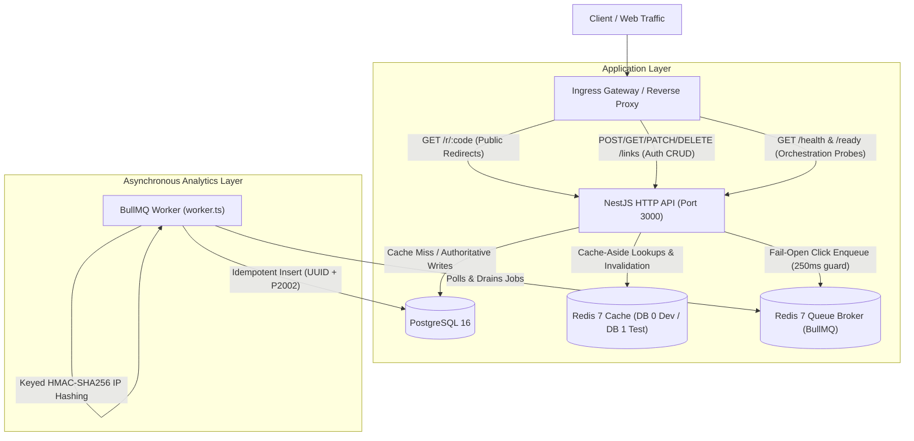

# System Design Fundamentals: Final Engineering Report
**Project:** Scalable URL Shortener & Real-Time Analytics Platform  
**Curriculum Track:** Upsk System Design Fundamentals (Practitioner & Operator Pack)  
**Overall Completion:** 10 of 10 Modules Completed (100% / Operator Complete)  
**Evaluated Milestone:** Module 10 — CI/CD & Deployment (Containerization & Deployment Preparation)  
**Repository Branch:** `main`  
**Status:** Locally Containerized & Deployment-Prepared  
**Date:** November 2026  

---

## 1. Executive Summary

This engineering report documents the architectural design, implementation, empirical failure testing, and production hardening of the **URL Shortener & Real-Time Analytics Platform**.

The system was developed iteratively across 10 progressive modules in the **Upsk System Design Fundamentals** curriculum. It demonstrates core system design and operational principles: low-latency public redirect resolution via in-memory caching, multi-tenant link isolation, privacy-preserving asynchronous click stream processing, and containerized deployment readiness with graceful shutdown handling.

All ten modules have been completed and verified with empirical test suites against isolated local infrastructure (PostgreSQL 16, Redis 7, Docker containers). The final module verification confirmed complete build reproducibility, multi-stage containerization under non-root security contexts, graceful SIGTERM termination handling, and end-to-end operational recovery from dependency failure.

The application is locally containerized and deployment-prepared. In accordance with strict operational verification standards, Docker-based deployment behaviors and CI workflow definitions were validated in local test environments; live cloud deployment to Railway and remote execution of GitHub Actions on hosted runners were not performed.

---

## 2. End-to-End System Architecture

The platform employs a **decoupled multi-service architecture** that isolates the high-frequency public read path from resource-intensive asynchronous analytical writes and database schema maintenance.



### Core Data Flow & Separation of Concerns

1. **Public Redirect Path (`GET /r/:code`)**:
   - Ingress routes traffic directly to the stateless NestJS API.
   - The API performs a cache-aside query against Redis Cache (using Redis DB 0 in development, and Redis DB 1 in isolated testing/drills).
   - **Cache Hit:** Resolves the authoritative URL directly from Redis and returns `HTTP 302 Found` with the `Location` header, bypassing database query overhead.
   - **Cache Miss:** Queries PostgreSQL with an indexed $O(\log N)$ unique B-Tree lookup on `links(code)`, populates Redis with a 300-second base TTL subject to a 0–10% subtractive jitter (effective TTL: 270–300s), and issues the 302 redirect.
   - **Non-Blocking Analytics Dispatch:** The API enqueues a click event into BullMQ with a 250ms fail-open guard. If Redis or the queue is saturated or unreachable, the redirect proceeds without failing the user's redirect request.

2. **Authenticated Management & Mutation Path (`/links`)**:
   - Protected by stateless 15-minute JWT tokens via `JwtAuthGuard`.
   - Rate limiting is enforced via in-memory per-node limits (NestJS `ThrottlerModule` with memory storage).
   - All mutations (`POST`, `PATCH`, `DELETE`) enforce query-level tenancy filters (`where: { id, createdBy: principalId }`).
   - Mutations commit to PostgreSQL first, followed immediately by active cache invalidation in Redis (`DEL redirect:v1:<code>`), guaranteeing stale redirect destinations are not served.

3. **Background Ingestion & Analytics Path (`worker.ts`)**:
   - A dedicated worker process runs independently of HTTP API instances.
   - Pulls click event jobs from the `analytics-queue`.
   - Protects visitor privacy by hashing raw IP addresses with a keyed HMAC-SHA256 secret before persistence. Raw client IPs are never written to disk or logs.
   - Employs client-generated UUID idempotency keys backed by a PostgreSQL `UNIQUE(idempotency_key)` constraint. Duplicate deliveries resulting from worker retries are gracefully caught (`P2002`) and ignored.

---

## 3. Module-by-Module Journey & Architectural Evolution

| Module | Core Domain | Architectural Choice | Downstream Impact & Rationale |
|---|---|---|---|
| **01** | Setup & Clean Code | Single-App Layout | Chosen over complex monorepo tooling to minimize build friction, enforce layered directory discipline (`controllers`, `services`, `dto`), and implement strict startup environment validation. |
| **02** | Database Design | PostgreSQL 16 + Prisma | Selected relational normalization over document stores. Created independent `links` and `click_events` tables with unique B-Tree indexes on `links(code)` and compound time-series indexes on `click_events(link_id, clicked_at DESC)` to prevent document bloat. |
| **03** | Core API & Validation | Dedicated `/r/` Prefix | Discarded root-level redirects (`/:code`) in favor of `/r/:code` to prevent route namespace collisions with administrative endpoints (`/health`, `/ready`, `/links`) and enable dedicated caching/rate-limit policies. |
| **04** | Authentication & Authz | 15-Minute JWTs + IDOR Protection | Implemented stateless JWT verification. Enforced defense-in-depth where every database query filters by `createdBy: principalId`, returning HTTP 404 for cross-owner lookups to prevent enumeration attacks. Rate limiting enforced in-memory per-node. |
| **05** | Error Handling & Logging | Fail-Fast Validation vs. Graceful Read Fallback | Applied strict fail-fast boundaries on inputs (400), authentication (401), and link writes, paired with graceful cache-to-database fallback on the redirect path. Implemented structured JSON logging with centralized PII and secret redaction. |
| **06** | Redis Caching | Cache-Aside with Subtractive TTL Jitter | Mitigated cache stampedes (thundering herd) using a 300-second base TTL with 0–10% subtractive jitter (270–300s). Implemented active cache invalidation on link updates and single-flight in-flight lookup coalescing. |
| **07** | Background Jobs | Asynchronous Queue (BullMQ) | Decoupled analytics writes from redirect responses using BullMQ. Added 250ms fail-open enqueue guards, keyed HMAC-SHA256 IP hashing, 5-attempt exponential backoff, and UUID idempotency keys to handle worker retries. |
| **08** | Search & Advanced Queries | PostgreSQL Trigram (`pg_trgm`) + GIN | Selected database-native trigram indexing over external search engines to maintain strong ACID consistency with zero data synchronization lag, bounded by strict pagination limits (`page_size` max 100). |
| **09** | Testing & Quality Assurance | Integration-Heavy Testing | Emphasized real database and Redis boundary tests over brittle mocks. Developed automated suites with strict pre-flight safety guards preventing tests from touching development data. |
| **10** | CI/CD & Deployment | Multi-Service Containerization | Packaged the application into a hardened multi-stage Docker container (`node:20-alpine`, non-root user `nestjs`), decoupled liveness from readiness probes, and verified SIGTERM graceful shutdown handling. |

---

## 4. Deep Dive: Module 10 (CI/CD & Deployment Preparation)

Module 10 packaged the application into a deterministic, locally containerized deployable unit.

### 1. Multi-Stage Dockerfile Architecture
The production image ([api/Dockerfile](api/Dockerfile)) implements container packaging best practices:
- **Builder Stage (`node:20-alpine AS builder`):**
  - Enables Corepack and activates `pnpm`.
  - Installs all dependencies with `--frozen-lockfile`.
  - Executes `prisma generate` to compile native query engine bindings.
  - Compiles TypeScript via `tsc`.
  - Runs `pnpm prune --prod` to discard devDependencies.
- **Runner Stage (`node:20-alpine AS runner`):**
  - Inherits from minimal `node:20-alpine`.
  - Creates a dedicated unprivileged user and group: `USER nestjs` (UID 1001).
  - Copies only the production `node_modules`, compiled `dist/`, and Prisma assets.
  - Final image footprint is **406 MB** (significantly smaller than standard Node images > 1 GB).

### 2. Dynamic Port & Host Binding
To ensure compatibility with container orchestrators:
- The server dynamically reads `process.env.PORT` with validation fallback.
- Explicitly binds to `0.0.0.0` (rather than `127.0.0.1` or `localhost`), ensuring external traffic ingress across container networking interfaces is accepted.

### 3. Decoupled Orchestration Probes (`/health` vs. `/ready`)
In containerized environments, conflating liveness and readiness leads to severe operational degradation:
- **Liveness (`GET /health`):**
  - An immediate in-memory check returning `HTTP 200 { ok: true }`.
  - Never initiates downstream I/O. If PostgreSQL or Redis experiences transient network blips, the API process remains running, preventing orchestrator restart loops (`CrashLoopBackOff`).
- **Readiness (`GET /ready`):**
  - Executes live dependency probes: PostgreSQL `SELECT 1` and Redis `PING`.
  - Returns `HTTP 200 { ok: true, status: "ready", db: "ok", redis: "ok" }` when dependencies are healthy.
  - Returns `HTTP 503 { ok: false, status: "unready", db: "unreachable", redis: "ok" }` within ~350ms during an outage, signaling ingress proxies to route traffic away from the instance without terminating the container.

### 4. Dedicated One-Off Migration Lifecycle
To prevent database race conditions and table deadlocks across horizontal container replicas:
- Migrations are decoupled from application startup.
- Configured dedicated npm script: `"migrate": "prisma migrate deploy"`.
- Enables running database migrations out-of-band in release phases before new application pods receive traffic.

### 5. Automated CI Pipeline Definition
Authored [.github/workflows/ci.yml](.github/workflows/ci.yml):
- Provisions automated `postgres:16-alpine` and `redis:7-alpine` service containers with health checks.
- Runs pnpm dependency installation, TypeScript compilation, Prisma migration deployment, and the complete integration test suite on every pull request.
- **Verification Note:** The CI workflow file was validated locally; remote execution on GitHub-hosted runners was not performed.

---

## 5. Empirical Failure Injection & Recovery Drills

A core requirement of the System Design curriculum was empirical failure reproduction before claiming resolution. All experiments were conducted in isolated container environments against `upsk_sdf_test` and Redis DB 1 (preserving development database `upsk_sdf` and Redis DB 0).

```
========================================================================================
MODULE 10 EMPIRICAL DRILL RESULTS
========================================================================================
1. Baseline Health:         /health -> 200 OK  |  /ready -> 200 OK
2. Injected Outage (DB):    /health -> 200 OK  |  /ready -> 503 Service Unavailable (343ms)
3. Operational Recovery:    /health -> 200 OK  |  /ready -> 200 OK (15/15 checks passed)
4. Graceful Shutdown:       HTTP In-Flight -> 200 OK (No ECONNRESET) | Exit Code: 0 (733ms)
5. Connection Drop:         PostgreSQL: 2 -> 1 | Redis: 4 -> 2
========================================================================================
```

### Drill 1: The BREAK Experiment (Dependency Outage)
- **Objective:** Reproduce the failure scenario: *"Readiness probes fail because dependencies are not reachable."*
- **Injection:** Reconfigured the test container `DATABASE_URL` to point to closed host port `5439`.
- **Observed Behavior:**
  - Liveness probe (`/health`) returned **HTTP 200 OK** in 96ms.
  - Readiness probe (`/ready`) returned **HTTP 503 Service Unavailable** in 343ms with `db: "unreachable"`.
  - The API process stayed alive, proving failure isolation.
- **Evidence:** Documented in [progress/evidence/module-10/break-experiments-report.md](progress/evidence/module-10/break-experiments-report.md) and [progress/evidence/module-10/break-repro-log.txt](progress/evidence/module-10/break-repro-log.txt).

### Drill 2: The FIX Experiment (Operational Recovery)
- **Objective:** Apply the minimal operational fix to restore readiness without application code changes.
- **Execution:** Restored the reachable PostgreSQL port `5432` pointing to `upsk_sdf_test`.
- **Observed Behavior:**
  - Container readiness restored immediately to **HTTP 200 OK** (`db: "ok"`, `redis: "ok"`).
  - All 15 verification assertions passed cleanly.
- **Evidence:** Documented in [progress/evidence/module-10/fix-verification-report.md](progress/evidence/module-10/fix-verification-report.md).

### Drill 3: Isolated Graceful Shutdown Drill (SIGTERM)
- **Objective:** Empirically verify container behavior under termination signals.
- **Execution:** Initiated an HTTP request to `/links` immediately before dispatching `docker stop` (SIGTERM).
- **Observed Behavior:**
  - The request initiated before termination received **HTTP 200 OK** without socket reset (`ECONNRESET`).
  - The container exited with **Exit Code 0** in approximately **733 ms**.
  - PostgreSQL active connections in `pg_stat_activity` dropped from 2 to 1; Redis client connections dropped from 4 to 2.
  - **Timing & Draining Qualification:** The HTTP response-end event occurred approximately 4 ms after Docker reported container stop completion. Strict response completion prior to container process exit was not established across process boundaries. Furthermore, while the tested request succeeded without `ECONNRESET`, this empirical drill does not guarantee that every concurrent in-flight request under all workloads will drain successfully during shutdown.
- **Evidence:** Documented in [progress/evidence/module-10/graceful-shutdown-drill.txt](progress/evidence/module-10/graceful-shutdown-drill.txt).

### Drill 4: End-to-End Reference Demo
- **Execution:** Executed the complete 7-step reference demo script via local container execution:
  1. Health & Readiness (200 OK)
  2. Protected Link Creation (401 without auth, 201 with JWT)
  3. Public Redirect (302 Found)
  4. Asynchronous Analytics (Worker drained BullMQ and persisted 2 clicks)
  5. Cache Invalidation (PATCH destination URL -> subsequent redirect resolved to new URL)
  6. Search & Pagination (200 OK with paginated array)
  7. Graceful Shutdown (Docker stop with code 0)
- **Evidence:** Documented in [progress/lab-notebook.md](progress/lab-notebook.md).

---

## 6. Security, Privacy & Data Safety Audit

| Safety Requirement | Enforcement Mechanism | Verification Status |
|---|---|---|
| **Development DB Isolation** | Dedicated `upsk_sdf_test` target; strict URL parsing guard | **PASS** (`upsk_sdf` preserved at 25 links, 0 clicks) |
| **Redis DB 0 Isolation** | Dedicated test cache on Redis DB 1 (`/1`) | **PASS** (Redis DB 0 preserved at 188 keys) |
| **No Secrets in Version Control** | `.gitignore` excludes `.env`, `api/.env`, and local caches | **PASS** (Zero secrets tracked) |
| **Least-Privilege Containers** | `USER nestjs` (UID 1001) in runner stage | **PASS** (Verified non-root runtime) |
| **PII Protection** | Keyed HMAC-SHA256 IP hashing before queuing | **PASS** (Zero raw IP addresses logged or stored) |
| **IDOR Protection** | Query-level multi-tenant filters (`createdBy: principalId`) | **PASS** (Cross-principal access returns 404) |

---

## 7. Verification Metrics & Test Matrix

The individual module verification suites were executed against isolated test databases and Redis DB 1. The documented verification results are:

| Module | Scope / Domain | Documented Verification Result | Evidence Log Path |
|---|---|---|---|
| **Module 04** | Authentication, Tenancy & In-Memory Rate Limiting | **31 / 31** checks passed | [progress/evidence/module-04/auth-ratelimit-tests.txt](progress/evidence/module-04/auth-ratelimit-tests.txt) |
| **Module 05** | Error Handling & PII Redaction Logging | **26 / 26** checks passed | [progress/evidence/module-05/error-logging-tests.txt](progress/evidence/module-05/error-logging-tests.txt) |
| **Module 06** | Redis Cache-Aside & Subtractive Jitter | **33 / 33** checks passed | [progress/evidence/module-06/redis-cache-tests.txt](progress/evidence/module-06/redis-cache-tests.txt) |
| **Module 07** | BullMQ Analytics Jobs & Idempotency | **21 / 21** checks passed | [progress/evidence/module-07/analytics-jobs-tests.txt](progress/evidence/module-07/analytics-jobs-tests.txt) |
| **Module 08** | Trigram Full-Text Search & Pagination | **17 / 17** checks passed | [progress/evidence/module-08/search-tests.txt](progress/evidence/module-08/search-tests.txt) |
| **Module 09** | Integration Test Suite & Pre-Flight Guards | **13 / 13** tests passed | [progress/evidence/module-09/integration-tests.txt](progress/evidence/module-09/integration-tests.txt) |
| **Module 10** | CI/CD, Container Build & Health Probes | **22 / 22** checks passed | [progress/evidence/module-10/health-readiness-tests.txt](progress/evidence/module-10/health-readiness-tests.txt) |
| **Final Demo** | 7-Step End-to-End System Verification | **7 / 7** steps passed | [progress/lab-notebook.md](progress/lab-notebook.md) |

---

## 8. Repository Status & Git Artifacts

The project repository has been prepared to professional standards:
- **Git Branch:** `main`
- **Initial Commit Hash:** `b9a1682`
- **Tracked Files:** Application source code, configuration, database migrations, CI pipeline, and safe technical verification reports.
- **Documentation:** Comprehensive 20-section [README.md](README.md) at repository root.

### Remote Push Instructions
When publishing to GitHub:
```powershell
git remote add origin https://github.com/<your-username>/<your-repo-name>.git
git push -u origin main
```

---

## 9. Known Limitations & Production Roadmap

1. **Deployment Scope Distinction:**
   All CI workflows and Docker container behaviors were verified locally via automated test runners and Docker daemon operations. A remote GitHub Actions execution and live Railway cloud deployment were not performed.
2. **Rate Limiting Architecture:**
   Rate limiting is currently implemented using in-memory per-node tracking (`ThrottlerModule`). In a multi-pod production cluster, migrating rate-limiting buckets to a shared Redis sliding-window implementation would provide uniform rate enforcement across all application pods.
3. **Distributed Tracing:**
   Currently, correlation tracking relies on `X-Request-Id` in structured JSON logs. Integrating OpenTelemetry would provide distributed span tracing across HTTP requests and BullMQ worker job executions.
4. **Dedicated Search Cluster:**
   PostgreSQL trigram search (`pg_trgm`) satisfies ACID consistency for current link volumes. For catalogs exceeding millions of links, synchronizing records to a dedicated search cluster (e.g., Elasticsearch or Meilisearch) represents the next architectural scaling step.

---

*Report prepared and certified following the completion of the Upsk System Design Fundamentals Operator track.*
