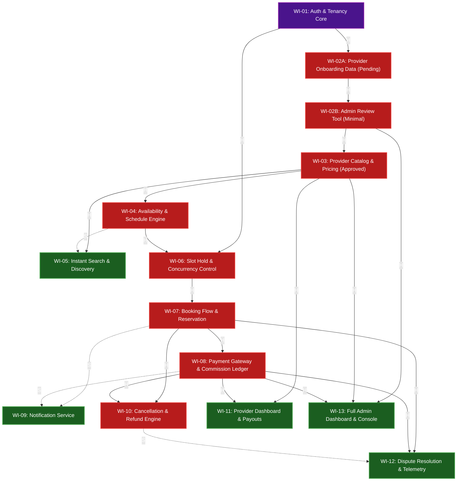

# SkillSwap Dependency Mapping & Critical Path DAG (Updated: Post-Cycle Fix)

## Executive Summary
This document translates SkillSwap's 20 extracted requirements into an executable **Directed Acyclic Graph (DAG)** of 13 buildable work items. Following the architectural diagnosis of a potential circular dependency between Provider Vetting, Admin Dashboard, and Provider Data, the cycle was resolved by **splitting the Admin Tooling node into a Minimal Review Tool on the critical path and a Full Admin Dashboard executing in parallel**.

Key Architecture Principles Applied:
- **Node Splitting:** Decoupling the minimal necessary vetting mechanism (CLI / single approve endpoint) from the rich UI/analytics console.
- **State Machine Decoupling:** Separating application submission (`PENDING_REVIEW`) from public catalog activation (`APPROVED`).
- **Critical Path Strategy:** Active timeline compression via interface contracts and minimal unblocking primitives.

---

## 1. Traceability: Requirements to Buildable Work Items

| Work Item ID | Title | Scope & Covered Requirements | Estimated Duration | Inbound Dependencies | Outbound Dependents |
|---|---|---|:---:|---|---|
| **WI-01** | **Auth & Tenancy Core** | User identity, JWT issuance/validation, RBAC (Learner, Provider, Admin), multi-city `city_id` tenant isolation (`REQ-18`, `REQ-20`). | 2 days | *None (Root Starter)* | WI-02A, WI-06 |
| **WI-02A** | **Provider Onboarding & Data Schema** | Provider registration form, bio, credential uploads, schema state machine (`DRAFT`, `PENDING_REVIEW`, `APPROVED`, `REJECTED`) (`REQ-14`). | 1 day | WI-01 [H] | WI-02B |
| **WI-02B** | **Admin Review Tool (Minimal)** | Lightweight admin API / CLI command to inspect `PENDING_REVIEW` applicants and transition status to `APPROVED` or `REJECTED` (`REQ-14`, `REQ-15`). | 1 day | WI-02A [H] | WI-03, WI-13 |
| **WI-03** | **Provider Catalog & Pricing** | Public profile projection for `APPROVED` providers, bios, verified badges, service offerings, hourly/session rates, rating aggregation (`REQ-03`, `REQ-10`). | 2 days | WI-02B [H] | WI-04, WI-05, WI-11, WI-13 |
| **WI-04** | **Availability & Schedule Engine** | Provider custom working hours, recurring schedules, slot generation, UTC normalization (`REQ-09`). | 3 days | WI-03 [H] | WI-05, WI-06 |
| **WI-05** | **Instant Search & Discovery** | Category taxonomy filtering, multi-city indexing, Redis query caching layer (<200ms p95) (`REQ-01`, `REQ-02`, `REQ-19`). | 2 days | WI-03 [H], WI-04 [S] | *None (Endpoint)* |
| **WI-06** | **Slot Hold & Concurrency Control** | 10-minute temporary hold state machine (`HELD`), distributed Redis lease, zero double-booking serializable lock (`REQ-04`, `REQ-05`, `REQ-19`). | 3 days | WI-01 [H], WI-04 [H] | WI-07 |
| **WI-07** | **Booking Flow & Reservation** | Booking entity lifecycle, checkout session creation, slot status transition (`HELD` $\to$ `CONFIRMED`) (`REQ-04`, `REQ-05`). | 2 days | WI-06 [H] | WI-08, WI-09, WI-10, WI-12 |
| **WI-08** | **Payment Gateway & Commission Ledger** | Credit/debit card processing (Stripe/Adyen), 15% marketplace commission deduction, double-entry ledger, custodial escrow hold (`REQ-06`, `REQ-12`). | 3 days | WI-07 [H] | WI-09, WI-10, WI-11, WI-12, WI-13 |
| **WI-09** | **Notification Service** | Asynchronous email dispatch (BullMQ/Redis), booking confirmations, cancellation alerts, reminder queue (`REQ-07`). | 1 day | WI-07 [S], WI-08 [S] | *None (Endpoint)* |
| **WI-10** | **Cancellation & Refund Engine** | Cancellation policy evaluation (**BLOCKED: Option 1 vs Option 2**), refund calculations, gateway refund reversals, state transitions (`REQ-08`). | 2 days | WI-07 [H], WI-08 [H] | WI-12 |
| **WI-11** | **Provider Dashboard & Payouts** | Historical bookings, earnings breakdown (`Pending Escrow`, `Available for Payout`, `Refunded`), payout triggers, reviews (`REQ-11`, `REQ-12`). | 2 days | WI-03 [H], WI-08 [H] | *None (Endpoint)* |
| **WI-12** | **Dispute Resolution & Telemetry** | Provider no-show flagging, learner dispute tickets, admin mediation console, structured telemetry stream (`REQ-13`, `REQ-16`, `REQ-17`). | 2 days | WI-07 [H], WI-08 [H], WI-10 [S] | *None (Endpoint)* |
| **WI-13** | **Full Admin Dashboard (Analytics & Disputes)** | Centralized web console for administrators: platform telemetry, multi-city analytics, bulk provider management, dispute mediation interface (`REQ-15`, `REQ-16`, `REQ-17`). | 2 days | WI-02B [H], WI-03 [H], WI-08 [H] | *None (Endpoint)* |

---

## 2. Visual Dependency Graph (ASCII Diagram)

```text
========================================================================================
             SKILLSWAP RESOLVED DEPENDENCY DAG (13 WORK ITEMS — CYCLE BROKEN)
========================================================================================

                 ┌──────────────────────────────────────┐
                 │  WI-01: Auth & Multi-City Tenancy    │  ◄── [ROOT STARTER]
                 └──────────────────┬───────────────────┘
                                    │
                  ┌─────────────────┴─────────────────┐
                  │ [H]                               │ [H]
                  ▼                                   ▼
┌───────────────────────────────────┐   ┌───────────────────────────────────┐
│ WI-02A: Provider Onboarding Data  │   │                                   │
│ (State: PENDING_REVIEW)           │   │                                   │
└─────────────────┬─────────────────┘   │                                   │
                  │ [H]                 │                                   │
                  ▼                     │                                   │
┌───────────────────────────────────┐   │                                   │
│ WI-02B: Admin Review Tool (Mini)  │   │                                   │
│ (Action: Transitions to APPROVED) │   │                                   │
└─────────┬─────────────────┬───────┘   │                                   │
          │ [H]             │ [H]       │                                   │
          ▼                 │           │                                   │
┌───────────────────┐       │           │                                   │
│ WI-03: Provider   │       │           │                                   │
│ Catalog & Pricing │       │           │                                   │
└───────┬───┬───────┘       │           │                                   │
        │   │               │           │                                   │
        │   └───────────────┼───────────┼───────────────────┐               │
        │ [H]               │           │                   │ [H]           │
        ▼                   ▼           │                   ▼               │
┌───────────────┐   ┌───────────────┐   │   ┌─────────────────────────────┐ │
│ WI-04: Sched  │   │ WI-13: Full   │   │   │ WI-05: Instant Search       │ │
│ & Availability│   │ Admin Console │   │   └─────────────────────────────┘ │
└───────┬───┬───┘   │ (Parallel)    │   │                  ▲                │
        │   │       └───────────────┘   │                  │ [S]            │
        │   └───────────────────────────┼──────────────────┘                │
        │ [H]                           │                                   │
        ▼                               ▼                                   │
┌───────────────────────────────────────────────────┐                       │
│ WI-06: Slot Hold & Concurrency Control            │ ◄─────────────────────┘
└─────────────────┬─────────────────────────────────┘
                  │ [H]
                  ▼
┌───────────────────────────────────────────────────┐
│ WI-07: Booking Flow & Reservation                 │
└─────────────────┬─────────────────────────────────┘
                  │ [H]
                  ▼
┌───────────────────────────────────────────────────┐
│ WI-08: Payment Gateway & Commission Ledger        │
└───┬─────────────┬─────────────────┬─────────────┬─┘
    │ [H]         │ [H]             │ [S]         │ [H]
    │             │                 ▼             │
    │             │   ┌─────────────────────────┐ │
    │             │   │ WI-09: Notification Svc │ │
    │             │   └─────────────────────────┘ │
    ▼             ▼                               ▼
┌───────────┐ ┌─────────────────────────┐ ┌───────────┐
│ WI-10:    │ │ WI-11: Provider Dash    │ │ WI-12:    │
│ Refund    │ │ & Payouts               │ │ Disputes  │
│ Engine    │ └─────────────────────────┘ └───────────┘
└─────┬─────┘                                   ▲
      │ [S]                                     │
      └─────────────────────────────────────────┘

Legend:
  [H] ── Solid Arrow: Hard Dependency (strict code/data prerequisite)
  [S] ── Dashed Arrow: Soft Dependency (procedural preference; mockable interface contract)
```

---

## 3. Mermaid Representation



---

## 4. Analysis of the Fix & Critical Path Impact

### 4.1 Proof of Cycle Resolution
- **Prior Cycle:** `Vetting` $\to$ `Admin Dashboard` $\to$ `Provider Data` $\to$ `Vetting`.
- **Resolved Flow:**
  $$\text{WI-02A (Data Ingestion: PENDING)} \to \text{WI-02B (Minimal Review Tool)} \to \text{WI-03 (Catalog: APPROVED)} \to \dots \to \text{WI-13 (Full Admin Console)}$$
- The cycle is completely eliminated. Every arrow is strictly forward-directed.

### 4.2 Critical Path Impact
- **Original Chain (Sequential Floor):**
  $$\text{WI-01 (2d)} \to \text{WI-02 (2d)} \to \text{WI-03 (2d)} \to \text{WI-04 (3d)} \to \text{WI-06 (3d)} \to \text{WI-07 (2d)} \to \text{WI-08 (3d)} \to \text{WI-10 (2d)} = \mathbf{19\text{ days}}$$
- **Resolved Chain with Split Node:**
  $$\text{WI-01 (2d)} \to \text{WI-02A (1d)} \to \text{WI-02B (1d)} \to \text{WI-03 (2d)} \to \text{WI-04 (3d)} \to \text{WI-06 (3d)} \to \text{WI-07 (2d)} \to \text{WI-08 (3d)} \to \text{WI-10 (2d)} = \mathbf{19\text{ days}}$$
- **Net Impact:** Total sequential floor remains identical at **19 business days**, but with significant operational advantages:
  1. **Parallel Execution Unlocked:** The heavy **`WI-13: Full Admin Dashboard`** (analytics, charts, bulk dispute tools) is entirely decoupled from the critical path and executes in parallel.
  2. **Zero Blockers to Vetting:** Admin approval capability is delivered in just 1 day via `WI-02B`, unblocking real provider vetting and catalog creation immediately.
