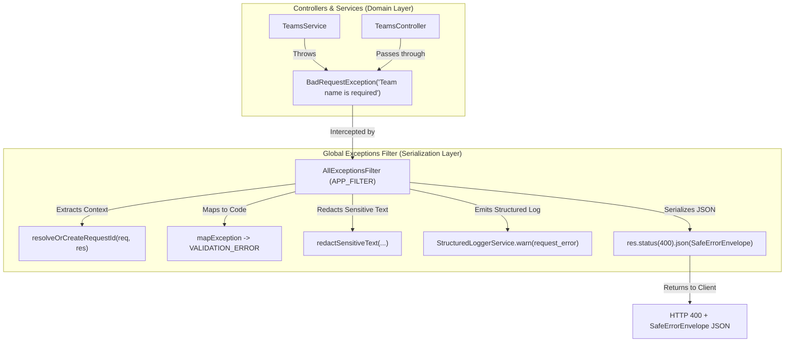

# Module 03 BREAK: The Convention Violation (API Error Contract Drift)

## 1. Executive Summary & Diagnostic Overview

During the implementation of the **Team Collaboration** feature (Tasks 1–3) on top of the NestJS & Prisma URL Shortener API, the first-pass generated code produced technically functional endpoints that validate input and handle error paths. However, an architectural review revealed a critical convention violation: **API Error Contract Drift**.

While existing endpoints format errors centrally through a standardized envelope, AI agents frequently fall back to ad-hoc error structures such as:
```json
{
  "status": "error",
  "message": "Team name is required.",
  "statusCode": 400
}
```
Although this structure appears logical and functional in isolated unit testing, it directly violates the project's established API contract, bypassing centralized exception handling and breaking downstream API consumers.

---

## 2. Actual Codebase Inspection & Standard API Error Contract

A comprehensive inspection of the existing codebase establishes how errors are designed and handled in production:

### Inspected Codebase Files:
1. [api/src/common/filters/all-exceptions.filter.ts](../../../api/src/common/filters/all-exceptions.filter.ts) — Global exception filter defining `SafeErrorEnvelope`, mapping Prisma/HTTP exceptions, and emitting structured logs.
2. [api/src/common/middleware/request-id.util.ts](../../../api/src/common/middleware/request-id.util.ts) — Request ID resolution, validation, and AsyncLocalStorage context storage.
3. [api/src/common/logging/structured-logger.service.ts](../../../api/src/common/logging/structured-logger.service.ts) — Production JSON logging with redaction.
4. [api/src/links/links.controller.ts](../../../api/src/links/links.controller.ts) — Standard controller throwing HTTP exceptions.
5. [api/src/links/links.service.ts](../../../api/src/links/links.service.ts) — Service layer throwing NestJS HTTP exceptions (`BadRequestException`, `NotFoundException`, `UnauthorizedException`).
6. [api/src/app.module.ts](../../../api/src/app.module.ts) — Centralized registration of `AllExceptionsFilter` via `APP_FILTER`.

### The Canonical API Error Envelope:
Lines 36–42 of `api/src/common/filters/all-exceptions.filter.ts` formally define the application's external error contract:

```typescript
export interface SafeErrorEnvelope {
  error: {
    code: string;
    message: string;
    request_id: string;
  };
}
```

### Standard Serialization in Action:
When any endpoint in the API encounters an error (e.g. invalid input, unauthorized access, or resource not found), the global filter intercepts the exception and produces:

```json
{
  "error": {
    "code": "VALIDATION_ERROR",
    "message": "Team name is required.",
    "request_id": "req_8e4a91c2b53f"
  }
}
```

### Registered Error Codes:
`AllExceptionsFilter.mapException()` deterministically maps exceptions to standard machine-readable codes:
- `VALIDATION_ERROR` — Class-validator failures or `BadRequestException` (HTTP 400)
- `INVALID_JSON` — Malformed body-parser syntax errors (HTTP 400)
- `UNAUTHORIZED` — Missing or invalid authentication token (HTTP 401)
- `FORBIDDEN` — Insufficient resource permissions (HTTP 403)
- `NOT_FOUND` — Target resource does not exist (HTTP 404)
- `CONFLICT` — Unique constraint collision / Prisma `P2002` (HTTP 409)
- `RATE_LIMITED` — Throttler rate limit exceeded (HTTP 429)
- `DATABASE_UNAVAILABLE` — Database connection or timeout failure (HTTP 503)
- `INTERNAL_ERROR` — Unhandled runtime error with internal details redacted (HTTP 500)

---

## 3. The Convention Violation: Detailed Comparison

### Side-by-Side Structural Contrast

| Dimension | Canonical Contract (`SafeErrorEnvelope`) | Violating Agent Output | Impact of Inconsistency |
| :--- | :--- | :--- | :--- |
| **Top-Level Key** | `{ "error": { ... } }` | `{ "status": "error", ... }` | Client SDKs reading `data.error` encounter `undefined` |
| **Machine Code** | `"code": "VALIDATION_ERROR"` | *None* | Prevents programmatic categorization and localized client error handling |
| **Traceability** | `"request_id": "req_8e4a9..."` | *None* | End-user cannot cite a trace ID; impossible to correlate with server logs |
| **Message Field** | `error.message` | `message` (top-level) | Inconsistent schema requiring custom client parser branching |
| **Redundant Data** | Only semantic payload | `"statusCode": 400` in JSON | Duplicates HTTP status line in JSON body |
| **Logging Event** | Structured `request_error` emitted | Completely bypassed if caught locally | Invisible to APM, metric dashboards, and alert monitors |

---

## 4. Downstream Consequences & Production Impact

1. **Frontend & Client SDK Parsing Crashes:**
   - Frontends (React, mobile apps, CLI consumers) implement centralized API client interceptors expecting the shape:
     ```typescript
     const { code, message, request_id } = response.data.error;
     ```
   - If the new `/teams` endpoint returns `{ status: "error", message: "..." }`, accessing `response.data.error.message` results in an uncaught `TypeError: Cannot read properties of undefined (reading 'message')`, crashing client views.
   - Forcing frontend teams to write defensive code (`response.data.error?.message || response.data.message`) creates technical debt and degrades API ergonomics.

2. **Bypassing Distributed Tracing & Support Inability:**
   - `SafeErrorEnvelope` guarantees that every error includes `request_id`, matching the `X-Request-Id` response header generated in `resolveOrCreateRequestId()`.
   - In ad-hoc error formats, `request_id` is omitted. When users encounter an error during team onboarding, support engineers cannot look up the request in log aggregators (CloudWatch, Sentry, Grafana Loki).

3. **Silent Failure in APM & Structured Logging:**
   - In `AllExceptionsFilter`, every exception triggers:
     ```typescript
     const logPayload = {
       event: 'request_error',
       request_id: requestId,
       route: sanitizeRoutePath(req.url),
       status_code: mapped.statusCode,
       error_code: mapped.code,
       error_message: redactSensitiveText(mapped.message),
     };
     ```
   - When controllers catch exceptions locally and serialize manual error JSON, the filter is bypassed. The server emits an `http_request` with status 200 or an untracked payload, completely blinding observability dashboards and SLO tracking.

4. **Information Leakage Risk:**
   - Ad-hoc error serialization in services often blindly serializes raw JavaScript `Error` objects or database error strings (`err.message`).
   - `AllExceptionsFilter` explicitly runs all messages through `redactSensitiveText()`, stripping database connection strings, credentials, or internal query parameters. Manually writing error JSON bypasses this security interlock.

---

## 5. Architectural Boundary: Where Error Formatting Belongs

In a clean NestJS architecture, error formatting has a strict separation of concerns:



### Architectural Principles:
1. **Controllers and Services Must NEVER Format Error JSON:**
   - Controllers and services must **never** call `res.status(400).json({ ... })` or return error dictionary objects.
   - They must exclusively throw standard NestJS HTTP exceptions (`BadRequestException`, `NotFoundException`, `ForbiddenException`, `ConflictException`, `UnauthorizedException`).
2. **Centralized Serialization is Inviolable:**
   - `AllExceptionsFilter` is registered globally as an `APP_FILTER` in `AppModule`.
   - It is the **single source of truth** for mapping exceptions into `SafeErrorEnvelope`, enforcing uniform structure, attaching request IDs, and logging structured metrics.

---

## 6. Context Engineering Root Cause & Preventive Strategy

### Why Did the Prompt Produce This Bug?
1. **Under-specified Error Handling Context:**
   - The task instructions in `progress/context-packages.md` specified: *"Check team exists; if not, throw NotFoundException. Check membership; if not, throw ForbiddenException."*
   - While it mentioned exception classes, it did not explicitly document the resulting HTTP wire format (`SafeErrorEnvelope`) or emphasize that error JSON should never be returned manually.
2. **Absence of Negative Constraints on Error Payloads:**
   - The prompt lacked an explicit negative constraint prohibiting custom JSON error objects (e.g., `{ status: "error" }`).
   - LLMs, having been trained on diverse Express, Fastify, and Flask repositories, frequently default to common boilerplate patterns like `{ status: "error", message: "..." }` when negative constraints are absent.

### Required Context Fix (For Step 6: FIX):
1. **System Context Enhancement:** Update `progress/system-context.md` to formally document `SafeErrorEnvelope` and declare the absolute rule: *"Never manually format error responses in controllers or services; always throw NestJS HttpExceptions."*
2. **Task Prompt Guardrails:** Add explicit negative constraints to all task prompts prohibiting ad-hoc error serialization.

