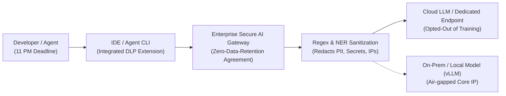

# Safety Interlude Reflection: Samsung's AI-Generated Code Leak

**Student:** Engineering Lead  
**Skill:** AI-Augmented Engineering (`ai-augmented-engineering`)  
**Context:** Delivered between Module 04 (Critical Review) and Module 05 (Iteration Patterns)  

---

## 1. Executive Summary & Incident Reconstruction

### The Incident: March 2023, Samsung Semiconductor (Hwaseong, South Korea)
In March 2023, Samsung Electronics lifted internal prohibitions on OpenAI's ChatGPT across its semiconductor division to capture industry-wide developer productivity gains. Within twenty days of lifting the restriction, three separate, uncoordinated, and non-malicious incidents occurred across different engineering divisions:

1. **Incident 1 (Proprietary Toolchain Source Code):** An engineer in the semiconductor fabrication group, debugging proprietary measurement database software, pasted confidential chip-manufacturing source code into ChatGPT to identify a bug. While the model identified the bug, proprietary algorithms representing billions of dollars in R&D and decades of trade secrets were transmitted to OpenAI's multi-tenant infrastructure. Under OpenAI's consumer terms of service at the time, prompt inputs were retained and eligible for future model training.
2. **Incident 2 (Yield & Strategic Meeting Notes):** In another division, an engineer pasted entire internal meeting transcripts and notes into ChatGPT to generate executive summaries. The text contained sensitive discussions regarding semiconductor manufacturing yields, process improvements, and competitive supplier positioning—data capable of shifting market valuations and supplier contracts.
3. **Incident 3 (Hardware Test Sequence Data):** A third engineer uploaded proprietary hardware test sequence data and asked ChatGPT to optimize the execution code.

### The Consequence
Because public cloud LLM interactions operate without a recall mechanism or cryptographic "undo", Samsung's security team realized the intellectual property had crossed a permanent boundary. Samsung responded with an immediate, company-wide ban on external generative AI tools (ChatGPT, Google Bard, Bing Chat) and spent months and substantial capital developing an internal, on-premise AI model with air-gapped data governance.

Meanwhile, industry surveys (e.g., Cyberhaven) revealed that Samsung was merely the first high-profile casualty of an industry-wide vulnerability: **11% of employee prompt data across corporate America contained confidential information** (source code, customer records, legal memos, and financial models).

---

## 2. The Core Tension: What Goes IN vs. What Comes OUT

In Module 04, our focus was **Critical Review of what comes OUT of the AI** (catching IDOR, SQL injection, dual-write partial failures, and hallucinated models). 

This safety interlude forces us to apply that same adversarial lens to **Prompt Hygiene and what goes IN to the AI**:
- The interface of an AI chat window or coding agent feels intimate, responsive, and private—resembling a senior engineering peer or an internal search bar.
- In reality, every unconfigured prompt sent to an external multi-tenant API is an **uncontrolled network egress event**. 
- The Samsung engineers were not malicious corporate spies; they were world-class engineers operating under delivery pressure who treated a text box as a computational scratchpad rather than an external data conduit.

---

## 3. Reflection Questions & Actionable Analysis

### Question 1: Where is your line? What would you NOT paste into a prompt?

#### The "Never-Egress" Perimeter:
My line between acceptable prompt context and forbidden data is defined by strict data classification, not developer mood or intuition:

1. **Credentials, Keys & Identity Tokens (Tier 0 - Absolute Prohibition):**
   - API secrets, AWS IAM keys, private TLS certificates, JWT signing secrets (`process.env.JWT_SECRET`), and database connection strings containing embedded credentials.
2. **Customer Data & PII / Regulated Information (Tier 1 - Absolute Prohibition):**
   - User database dumps, raw email addresses, passwords, password hashes, billing identifiers, and session tokens. In our URL Shortener project, raw IP addresses must never leave the system—they are hashed via keyed HMAC (`ipHash`) at the perimeter.
3. **Proprietary Core Intellectual Property & Business Rules (Tier 2 - Strict Isolation):**
   - Core proprietary algorithms (e.g., high-frequency trading logic, custom compression algorithms, semiconductor fabrication test sequences).
4. **Internal Operational Artifacts (Tier 3 - Strict Isolation):**
   - Unreleased board presentations, roadmap memos, confidential yield metrics, and customer pricing negotiations.

#### Grounding to the Real Codebase:
In our NestJS & Prisma URL Shortener & Analytics platform:
- **Acceptable Context:** Interface definitions (`SafeErrorEnvelope`, `Link`, `CreateLinkDto`), abstract controller skeletons, general NestJS decorators (`@UseGuards(JwtAuthGuard)`), and isolated utility algorithms (e.g., Base62 encoding math).
- **Forbidden Context:** Live `.env` files, production database connection strings, real customer link redirection targets, analytics database query dumps containing customer traffic patterns, and internal VPC network addresses.

#### Enforcement:
The line must never be left to developer memory. It must be enforced via:
- Automated pre-commit hooks (`gitleaks`, `trufflehog`) scanning prompt packages and git diffs for credentials.
- CI/CD quality gates blocking secrets from landing in context packages.
- Strict workspace exclusion rules (`.gitignore`, `.dockerignore`) preventing sensitive files from entering agent working contexts.

---

### Question 2: Was there a middle path between a blanket ban and unconstrained leakage? What controls survive the "11 PM pressure test"?

#### Why Blanket Bans Fail:
Samsung's reaction—a complete ban on external AI tools—is understandable from an immediate risk perspective, but ultimately self-defeating:
1. **The Rise of "Shadow AI":** Under delivery pressure, engineers will bypass corporate network bans by switching to personal laptops, mobile hotspots, or unmanaged accounts. Banning the tool does not eliminate demand; it merely blinds corporate security to ongoing data leaks.
2. **Competitive Deceleration:** Depriving engineers of modern AI-assisted code generation, refactoring, and test authoring degrades development velocity relative to competitors who implement secure adoption frameworks.

#### The Middle Path Architecture:
A resilient, production-ready AI governance model incorporates five layered controls:

1. **Enterprise Zero-Retention Agreements (Commercial Layer):**
   - Organizations must contract with AI vendors through Enterprise agreements (e.g., Azure OpenAI Service, AWS Bedrock, Google Cloud Vertex AI, or OpenAI Enterprise) that provide legally binding, SOC2-certified **Zero Data Retention (ZDR)** and explicit contractual guarantees that prompt inputs and completions are **never used to train base models**.
2. **Enterprise AI Proxy with Automated DLP Scrubbing (Network Layer):**
   - All outgoing developer prompts route through an internal corporate AI gateway.
   - The gateway automatically executes fast regex and Named Entity Recognition (NER) models to intercept and redact API keys, JWT tokens, AWS ARNs, credit card numbers, and internal IP addresses before the payload exits the corporate perimeter.
3. **Synthetic Context & Minimal Interface Engineering (Engineering Discipline):**
   - As practiced in Module 03 (*Context Engineering*), developers must be trained to supply **synthetic interfaces and structural mocks** rather than pasting production database dumps or entire multi-thousand-line proprietary files.
4. **Air-Gapped / Self-Hosted Models for Core Secrets (Infrastructure Layer):**
   - For Tier 1 proprietary code (such as semiconductor test vectors or proprietary trading heuristics), organizations should host open-weight coding models (e.g., Llama 3, Qwen 2.5 Coder, DeepSeek-Coder) within internal Kubernetes clusters or air-gapped workstations where data never touches the public internet.

#### Surviving the "11 PM Developer Pressure Test":
A security control that introduces friction will fail at 11 PM when an engineer is battling a critical production outage:
- **If security requires filing an access ticket or manually redacting 500 lines of code, the developer will bypass it.**
- **To survive the 11 PM test, security must be zero-friction and ambient:**
  - The developer's IDE agent must default to an approved enterprise endpoint with zero manual configuration.
  - Redaction must occur automatically at the proxy layer or via silent IDE plugins.
  - The tool must "just work" while operating entirely within a legally and architecturally bounded sandbox.

---

## 4. Key Takeaways for Module 05 & Beyond

1. **Every Prompt is an Egress Boundary:** Ingesting context into an AI model is an architectural transaction. Treat prompt context with the same security classification as an external HTTP API payload.
2. **Synthesize and Abstract Context:** Feed agents interfaces, schemas, and synthetic exemplars rather than raw proprietary source code.
3. **Automate the Interlocks:** Rely on automated proxies, regex sanitizers, and zero-retention enterprise contracts to protect data sovereignty, because under pressure, human vigilance will always fail.
