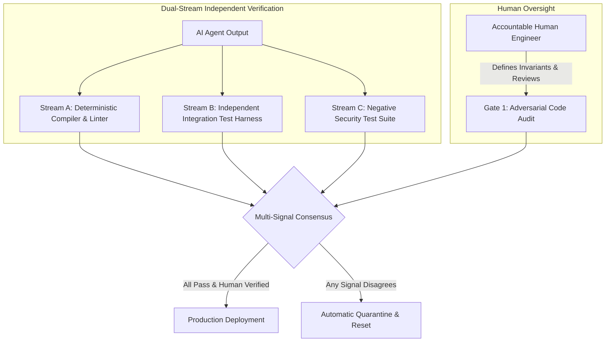

# Safety Interlude: The Boeing 737 MAX — Automation vs. Override

**Course**: Upsk AI-Augmented Engineering Practitioner Pack  
**Context**: Interlude delivered between Module 06 (Parallel Agent Management) and Module 07 (Security & Architecture Review)  
**Date**: November 18, 2026  
**Status**: Completed  

---

## 1. Incident Reconstruction: The Catastrophic Cost of Silent Automation

### Documented Historical Facts

Between October 2018 and March 2019, two brand-new Boeing 737 MAX 8 commercial airliners crashed within minutes of takeoff, killing all 346 passengers and crew on board:
1. **Lion Air Flight 610 (October 29, 2018)**: Crashed into the Java Sea 13 minutes after departing Jakarta, Indonesia; 189 fatalities.
2. **Ethiopian Airlines Flight 302 (March 10, 2019)**: Crashed near Bishoftu, Ethiopia, 6 minutes after departing Addis Ababa; 157 fatalities.

Subsequent investigations by the Indonesian KNKT, Ethiopian AIIC, US NTSB, and US House Committee on Transportation and Infrastructure documented the following factual sequence:

- **Commercial & Aerodynamic Genesis**: To counter Airbus's fuel-efficient A320neo without designing a clean-sheet aircraft (which would have cost billions of dollars, taken years, and required expensive flight-simulator pilot retraining for a new type rating), Boeing fitted larger, more efficient CFM LEAP-1B engines onto the existing 50-year-old 737 airframe. Because the engines could not fit beneath the low-slung wings, they were positioned higher and further forward. At high angles of attack (AoA), the engine nacelles generated aerodynamic lift, creating an uncommanded pitch-up tendency that increased the risk of an aerodynamic stall.
- **The Software Compensator (MCAS)**: Instead of restructuring the airframe, Boeing engineered MCAS (Maneuvering Characteristics Augmentation System). MCAS was programmed to automatically trim the horizontal stabilizer to push the aircraft's nose down when it detected an excessively high angle of attack, thereby emulating the handling qualities of older 737 Next Generation (NG) models.
- **Single Point of Failure (SPOF)**: Although the 737 MAX was manufactured with two Angle of Attack sensors (one on each side of the fuselage), MCAS was designed to read from only **one sensor** during any given flight, alternating between the left and right sensors on successive flights. There was no cross-comparison or plausibility check between the two sensors.
- **Unbounded Authority & Override**: When a single sensor failed (as occurred on both flights due to electrical, mechanical, or calibration faults, reporting an AoA ~20° higher than actual), MCAS activated automatically. In both crashes, MCAS repeatedly engaged every 5 seconds each time the flight crew used electric trim to recover. The automated system had sufficient authority to deflect the stabilizer to its mechanical limits, completely overpowering the pilots' physical ability to pull back on the control columns.
- **Concealment & Lack of Feedback**: To maintain common type rating status with the FAA and avoid mandatory simulator training (a key commercial selling point to airlines), Boeing removed references to MCAS from the Flight Crew Operations Manual (FCOM). The pilots were never informed that MCAS existed. Furthermore, the cockpit "AoA Disagree" warning light had been made an optional, paid add-on feature that was disabled on both accident aircraft.

### Facts vs. Assumptions

| Dimension | Documented Historical Fact | Common Erroneous Assumption |
| :--- | :--- | :--- |
| **System Identity** | MCAS was a flight control augmentation law designed to satisfy certification handling requirements. | MCAS was an "autopilot" or an AI system that malfunctioned. |
| **Hardware Redundancy** | Two AoA vanes physically existed on every 737 MAX, but software deliberately queried only one. | The aircraft lacked physical sensors or hardware redundancy. |
| **Pilot Awareness** | Pilots were intentionally not trained on MCAS; documentation was excised from the flight manual. | The pilots panicked or failed to follow standard checklist procedures. |
| **Root Cause** | A cascade of commercial pressures to avoid simulator retraining led to compromised safety architecture. | The crashes were caused solely by a single defective $20 sensor. |

---

## 2. Core Engineering Lessons

The 737 MAX catastrophe serves as the quintessential case study on the perils of automation, offering critical lessons for software engineering and AI orchestration:

1. **Automation Must Never Have Silent, Unbounded Authority**:
   When automation is granted the authority to execute state-changing actions repeatedly without human consent, it ceases to be an assistant and becomes an uncontrollable rogue actor. Systems must implement rate-limiting, activation caps, and explicit human override priority.
2. **Single Points of Failure Are Lethal in Feedback Loops**:
   Relying on a single data feed without cross-validation or plausibility boundaries guarantees that corrupt input produces catastrophic output. Redundancy without cross-checking is an illusion.
3. **Observability Is a Safety Prerequisite, Not an Upsell**:
   A human cannot diagnose or override a failure they cannot observe. Operating in the dark while an automated process secretly modifies state robs the human of mental models and situational awareness.
4. **Commercial Pressure Compromises Risk Classification**:
   When engineering decisions are subordinated to commercial metrics (e.g., "avoid simulator retraining" or "meet sprint delivery dates"), hazards are artificially downgraded from "catastrophic" to "hazardous" to bypass rigorous verification gates.

---

## 3. Reflection Questions: Applied to AI-Augmented Workflows

### Question 1: Who has the last word — you or the AI?

> *In your workflow, who has the last word — you or the AI? If the AI generates code you are unsure about, do you accept it because "the AI probably knows something I don't"? The pilots of Lion Air 610 pulled back on the controls. They knew something was wrong. The machine disagreed and overrode them. When your instinct says the AI's output is wrong but you cannot articulate why, what do you do?*

#### 1. The Human Retains Absolute Control Authority
In our AI-augmented engineering practice, **the human engineer always has the last word**. An AI model is an ungrounded probabilistic token generator; it possesses no legal accountability, no moral agency, and no understanding of system lifecycle, operational safety, or business liabilities. 

Treating an AI's code with the deference of *"the AI probably knows something I don't"* is the exact cognitive bias that doomed Lion Air 610. When developers assume the machine is superior simply because it generates syntactically polished code rapidly, they surrender control authority.

#### 2. Protocol When Instinct Signals a Flaw
When intuition warns that AI output is problematic but the root cause is not immediately articulable, we enforce a strict **Four-Step Interlock Protocol**:
1. **Immediate Execution Freeze (Pull Back the Controls)**: Never accept, merge, or stage code based on vibes or superficial compiler passes. If an output feels off, it is quarantined immediately.
2. **Deconstruction & Property Verification**: Break the generated code down to its atomic invariants:
   - *State Mutation*: What does this line change in the database, memory, or session?
   - *Identity & Authorization*: Does this code enforce complete mediation, or does it make assumptions about the caller? (e.g., as we discovered in Module 06 with `if (arguments.length > 1)`).
   - *Boundary Conditions*: What happens on `null`, `undefined`, empty arrays, negative numbers, or concurrent requests?
3. **Adversarial Negative Testing**: Write an automated test specifically designed to break the suspected code before attempting to modify it. If the code cannot defend its invariants under adversarial testing, the instinct is validated.
4. **Clean Restart vs. Compounding Patching**: If the design is structurally murky, discard it completely (applying our **Two-Iteration Rule** from Module 05). Re-prompt with strict negative constraints rather than negotiating with an incoherent model.

---

### Question 2: What is the single point of failure in an AI workflow?

> *The MCAS system had a single point of failure: one sensor. If that sensor gave bad data, the entire system behaved catastrophically. What is the single point of failure in an AI-augmented workflow? The AI model itself? The context you provided? The tests you wrote? Or is it you — one human reviewer, tired, trusting, skimming a diff at the end of a long day?*

#### 1. Analysis of System Vulnerabilities
- **The AI Model**: Models hallucinate, invent non-existent APIs, and optimize for plausibility rather than correctness. However, a model is not a solitary point of failure if surrounded by deterministic linters, compilers, and sandboxed test runners.
- **The Context / Prompts**: Incomplete or ambiguous context introduces architectural drift (as we experienced in Module 06 when interface contracts omitted end-to-end event data flow). Yet, poor context usually produces noisy output that fails test assertions.
- **The Test Suite**: Tests can be brittle or biased. If the same AI agent generates both the implementation and the tests, it will mirror its own blind spots, asserting that invalid behavior is correct.

#### 2. The Ultimate Single Point of Failure: The Fatigued Human Reviewer
The true, catastrophic single point of failure in an AI-augmented development workflow is **the uncalibrated, fatigued human engineer**.

When an engineer reviews an extensive AI-generated pull request at 11:00 PM under deadline pressure:
- **Automation Bias Takes Over**: Because the code conforms to linting conventions, passes TypeScript compilation (`tsc`), and displays green checkmarks on basic unit tests, the reviewer relaxes their critical scrutiny.
- **Superficial Review Replaces Deep Verification**: The reviewer skims the diff, admiring clean variable names and comments, while missing semantic landmines: missing authorization guards, cross-tenant data leaks, race conditions, or unhandled exceptions.
- **The Human Becomes Boeing's Single AoA Sensor**: If the sole human gatekeeper rubber-stamps flawed code, the safety perimeter is breached entirely. The AI generated the defect, the test suite failed to catch it, but the human made the fateful decision to deploy it.

---

## 4. Architectural Guardrails: Constructing Modern "Hardware Interlocks"

To ensure our AI workflows never recreate the MCAS failure mode, we institute six non-negotiable architectural guardrails:

### The Six Interlocks:
1. **Dual-Sensor Cross-Validation (Never Trust a Single Model Output)**:
   Never allow an AI agent to verify its own code. An independent test suite or a secondary adversarial review agent must evaluate the implementation against external specifications.
2. **Absolute Human Override Authority**:
   No AI agent is ever granted autonomous deployment, merging, or infrastructure provisioning rights. The human remains in the loop with full authority to halt or revert execution.
3. **Complete Fail-Closed Mediation**:
   Any missing security context, authorization parameter, or authentication token must result in an immediate fail-closed state (`401 UNAUTHORIZED` / `403 FORBIDDEN`), exactly as remediated in `comments.service.js`.
4. **Bounded Autonomous Action**:
   AI agents operating in iterative loops must be strictly bounded (e.g., maximum 2 refinement cycles). If an agent fails to resolve an issue within 2 iterations, the process must stop and escalate to the human rather than compounding errors.
5. **Continuous Observable Telemetry**:
   Every agent action, tool invocation, and state mutation must be recorded in structured, immutable audit trails. Silent background operations without telemetry are forbidden.
6. **Separation of Generator and Evaluator**:
   The entity that authors application logic must never author the acceptance criteria or pass judgment on its own security compliance.

---

## 5. Conclusion: Moving into Module 07

The Boeing 737 MAX tragedy proves that when speed and convenience supersede rigorous safety architecture, disaster is inevitable. As we transition from **Module 06 (Parallel Agent Management)** into **Module 07 (Security & Architecture Review)**, we carry forward this foundational discipline:

> **Automation accelerates execution; engineering judgment guarantees survival. The human must always have the final word, the authority to override, and the independent verification tools to prove that the system is safe.**
