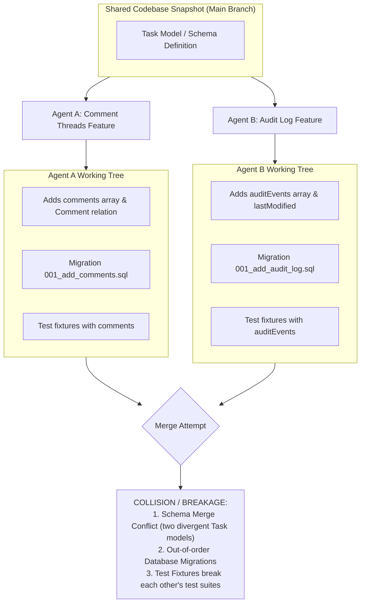
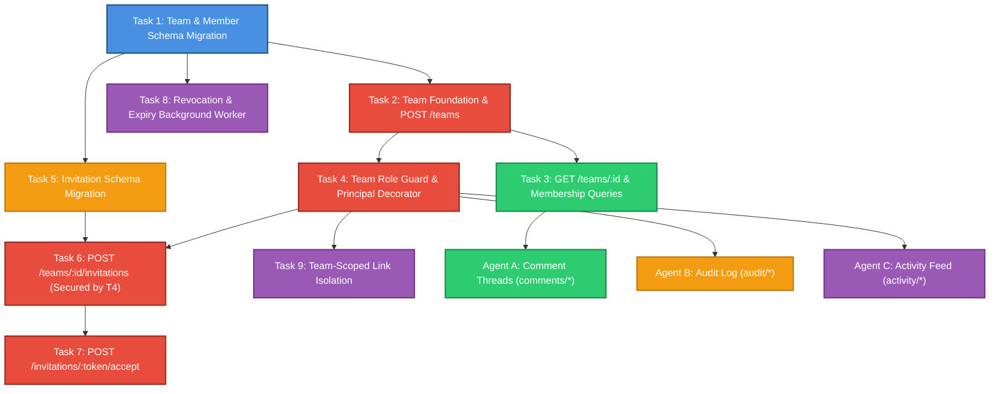

# Module 06: Multiple Agents, One Codebase — STEP 1: CONTEXT
## Parallel Agent Execution, The Merge Problem & Interface Contracts

**Course**: Upsk AI-Augmented Engineering (Practitioner Pack)  
**Module**: Module 06 — Multiple Agents, One Codebase  
**Step**: STEP 1: CONTEXT — Multiple Agents, One Codebase  
**Objective**: Analyze the economics, concurrency hazards, and architectural coordination patterns required to execute multiple AI coding agents in parallel against a single repository.

---

## 1. The Speed Argument vs. The Integration Hazard

### The Economic Rationale for Parallelism
In Modules 01 through 05, execution followed a strict sequential loop:
$$\text{Prompt} \longrightarrow \text{Generate} \longrightarrow \text{Review} \longrightarrow \text{Verify} \longrightarrow \text{Merge}$$

While sequential execution is predictable and minimizes context pollution, it scales linearly:
- In our Module 02 decomposition, the Team Collaboration feature consists of **9 atomic tasks** (and up to 12 tasks including extended backlog items like Comments, Mentions, and Audit Logs).
- At an average of 15 minutes per task (prompt engineering, generation, adversarial audit, and test verification), sequential execution requires:
  $$12 \text{ tasks} \times 15 \text{ minutes} = 180 \text{ minutes (3 hours)}$$
- If 4 independent agents execute in parallel across decoupled feature boundaries, the total wall-clock time drops to roughly **45 to 60 minutes** (a **$3\times$ speedup**).

### The Merge Problem: Distributed Systems in Code Generation
Parallel speed introduces an integration challenge analogous to distributed concurrency anomalies (split-brain, lost updates, and write skew):

#### Why Both Agents Are "Right," Yet Together They Break
1. **Schema Divergence**: Agent A adds `comments Comment[]` to `model Task`. Agent B adds `auditEvents AuditEvent[]` and `lastModified DateTime` to `model Task`. Both edit the same lines in `schema.prisma`.
2. **Database Migration Clashes**: Both agents generate migration files based on the same parent commit. Running Prisma migrations sequentially fails because neither migration incorporates the other's columns or foreign keys.
3. **Fixture Incompatibility**: Agent A's integration tests populate mock tasks without `lastModified` or `auditEvents`. Once Agent B merges, Agent A's test suite fails CI because the required audit columns are missing from Agent A's fixtures.
4. **The Core Lesson**: When multiple autonomous agents operate on shared mutable state (shared data models, global singletons, or shared route files) without coordination, integration collisions are inevitable.

---

## 2. The Construction Analogy & The Interface Contract

### The Electrical and Plumbing Crews
When building a house, general contractors do not hire one subcontractor at a time. The electrical crew and plumbing crew work simultaneously on the same structure. 

However, if both crews work without a **shared architectural floor plan**:
- The plumber runs drain pipes through the exact cavity the electrician reserved for the main service breaker panel.
- Fast work yields a catastrophic, expensive collision.
- The solution is never *"hire only one trade at a time."*
- The solution is a **shared floor plan** that strictly defines where wires run, where pipes run, and where they interface.

### The Software Floor Plan: Interface Contracts
In AI-augmented engineering, the shared floor plan is the **Interface Contract**:
- Before spawning parallel agents, the human coordinator locks down:
  1. **Schema Partitioning**: Either agree on the shared model diff *before* running agents, or design features to use separate relational tables connected by foreign key IDs rather than altering existing tables.
  2. **Type Contracts (DTOs & Interfaces)**: Formal TypeScript interfaces defining exact inputs and outputs.
  3. **Module & File Boundaries**: Disjoint file sets (e.g. `src/comments/` vs. `src/audit/`) so git merges are purely additive.

---

## 3. Micro-Exercise: Parallel vs. Sequential Decomposition

Grounded in our actual URL Shortener and Team Collaboration backlog:
- **Feature Set**: Team Invitations, RBAC Guards, Activity Feed, Comment Threads, @Mentions, and Audit Log.

### Question 1: Which tasks can run in parallel?
Tasks can run concurrently if and only if:
1. They share no mutable files or database tables.
2. Neither task consumes an output that the other task produces.
3. They introduce independent route namespaces and standalone Prisma models.

**Parallel Execution Batches**:
- **Batch 1 (Foundational Schema & Core API)**:
  - *Task 1: Team & Member Schema Migration* must land first.
- **Batch 2 (Core Endpoints & Invitation Foundation — Concurrent)**:
  - *Agent 1*: Task 2 (`POST /teams`) & Task 3 (`GET /teams/:id`) in `api/src/teams/`.
  - *Agent 2*: Task 5 (`Invitation Schema Migration`) in `api/prisma/schema.prisma`.
- **Batch 3 (Independent Feature Extensions — Concurrent)**:
  - *Agent A (Comment Threads)*: Works strictly within `api/src/comments/` with a separate `Comment` model referencing `teamId` and `taskId`.
  - *Agent B (Audit Log)*: Works strictly within `api/src/audit/` with a separate `AuditLog` model listening to pub/sub events.
  - *Agent C (Activity Feed Gateway)*: Works strictly within `api/src/activity/` implementing the WebSocket gateway.

### Question 2: Which tasks MUST be sequential?
Tasks MUST be executed sequentially when there is an explicit data, schema, or authorization dependency:
1. **Schema Precedence**: Task 1 (`Team & Member Schema`) MUST precede Task 2 (`POST /teams`) and Task 4 (`Team Role Guard`). A controller cannot query tables that do not exist.
2. **Authorization Precedence (Security Perimeter)**: Task 4 (`Team Role Guard`) MUST precede Task 6 (`POST /teams/:id/invitations`). As demonstrated in Module 04, building the invitation endpoint before the role guard creates an exploitable IDOR vulnerability.
3. **Lifecycle Precedence**: Task 5 (`Invitation Schema`) MUST precede Task 6 (`Create Invitation`), which MUST precede Task 7 (`Accept Invitation`). You cannot accept an invitation token whose database record and verification lifecycle have not been implemented.

---

### Question 3: The Dependency Graph (DAG)

### Architectural Dependency & Boundary Matrix

| Task / Feature | File Scope | Database Tables Modified | External Dependencies | Parallel Eligibility |
|---|---|---|---|:---:|
| **Task 1: Team Schema** | `api/prisma/schema.prisma` | `teams`, `team_members` | None (Root) | **Sequential (Blocker)** |
| **Task 2: POST /teams** | `api/src/teams/*` | `teams`, `team_members` | Task 1 | Sequential |
| **Task 3: GET /teams/:id** | `api/src/teams/teams.controller.ts` | Read-only queries | Task 2 | **Parallel with Task 5** |
| **Task 4: Team Role Guard** | `api/src/teams/guards/*` | Read-only check on `team_members` | Task 2 | Sequential (Security Blocker) |
| **Task 5: Invitation Schema** | `api/prisma/schema.prisma` | `invitations` | Task 1 | **Parallel with Task 3 & 4** |
| **Task 6: Create Invitation** | `api/src/teams/invitations.*` | `invitations` | Task 4, Task 5 | Sequential |
| **Task 7: Accept Invitation** | `api/src/teams/invitations.*` | `invitations`, `team_members` | Task 6 | Sequential |
| **Agent A: Comments** | `api/src/comments/*` | `comments` (New Table) | Task 1 (Team ID) | **Parallel with B & C** |
| **Agent B: Audit Log** | `api/src/audit/*` | `audit_logs` (New Table) | Task 4 (Principal) | **Parallel with A & C** |
| **Agent C: Activity Feed** | `api/src/activity/*` | In-memory Pub/Sub | Task 4 (Principal) | **Parallel with A & B** |

---

## 4. Key Takeaways for Multi-Agent Coordination

1. **Never Allow Uncoordinated Edits to Shared Files**:
   If two parallel agents edit `schema.prisma` or `app.module.ts` simultaneously, Git merge conflicts and semantic migration collisions are guaranteed.
2. **Decompose Along Disjoint Domain Directories**:
   Parallelism succeeds when Agent A owns `src/comments/`, Agent B owns `src/audit/`, and Agent C owns `src/activity/`.
3. **Interface Contracts Are Pre-Conditions for Parallelism**:
   Before launching parallel agents, the coordinator must freeze the data schemas, DTO interfaces, and authentication guards. Once contracts are fixed, agents can build in isolation with 100% confidence that their components will integrate cleanly.
