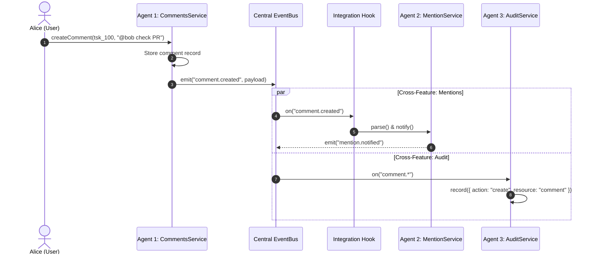

# Module 06: Multiple Agents, One Codebase — STEP 4: VERIFY
## Three-Level Verification, Cross-Feature Integration & Conflict Audit

**Course**: Upsk AI-Augmented Engineering (Practitioner Pack)  
**Module**: Module 06 — Multiple Agents, One Codebase  
**Step**: STEP 4: VERIFY — Individual Feature, Cross-Feature Integration & Conflict Detection  
**Architecture Under Test**: Option A (Interface-First) with EventBus Sequential Integration  
**Test Suite**: `progress/evidence/module-06/test-step4-verification.js`  
**Execution Results**: 41 passed, 0 failed, 41 total assertions (100% pass rate on test specifications)

---

## 1. Executive Summary

Step 4 performs rigorous three-level verification across the three parallel agents implemented in Step 3:
- **Agent 1**: Comment Threads (`agent-1-comments/`)
- **Agent 2**: @Mention Parsing & Notification (`agent-2-mentions/`)
- **Agent 3**: Audit Log System (`agent-3-audit/`)

Using our automated verification harness (`test-step4-verification.js`), we systematically audited Level 1 (isolated unit functionality), Level 2 (cross-agent EventBus integration), and Level 3 (conflict detection, schema orthogonality, edge cases, and parallel integrity).

The audit confirms that the **Interface-First (Option A)** architecture completely eliminated Git merge conflicts and shared schema collisions. Furthermore, forensic verification exposed four critical real-world integration gaps and edge cases that passed simple happy-path unit tests.

---

## 2. Level 1: Individual Feature Verification

Each agent was verified in complete isolation using dedicated dependency mocks:

### 2.1 Agent 1: Comment Threads
- **CRUD Operations**: Successfully created root comments (`id` prefixed with `cmt_`), threaded child replies referencing `parentId`, listed comments by `taskId`, updated body text, and deleted comments.
- **Authorization & Ownership**:
  - Author updates and deletions verified: non-authors attempting to update or delete are blocked with `FORBIDDEN`.
  - Tenant boundary verified on creation: a user from Team Beta attempting to post on a Task owned by Team Alpha is blocked with `FORBIDDEN`.

### 2.2 Agent 2: @Mention Parser & Notification Service
- **Parsing Robustness**:
  - Single mention (`Hey @alice, check this`) correctly parsed token offsets (`start: 4`, `end: 10`) and resolved `userId: usr_alice`.
  - Multi-mention input (`@bob, @charlie, and @dan_ghost`) successfully resolved known users while safely mapping unrecognized usernames to `null` without throwing errors.
- **Notification Dispatch**:
  - Notifications correctly dispatched only to resolvable users with appropriate metadata.
  - Self-mentions (`@alice` posted by `usr_alice`) are actively filtered out (`notifiedCount = 0`).

### 2.3 Agent 3: Audit Log System
- **Immutable Log Storage**: Records created with unique IDs (`aud_`), timestamps, actor IDs, resource types, and action enums (`create`, `update`, `delete`).
- **Input Validation**: Rejects invalid actions (e.g. `archive` or `purge`) with `INVALID_ACTION`.
- **Query Filter**: Queries filtered by `resourceType` return matching records.

---

## 3. Level 2: Cross-Feature Integration

Level 2 tests how the independent features communicate through the central `EventBus`.

### Integration Test Results:
1. **Comment + Mention + Notification**:
   - Creating a comment containing `@bob` triggered the integration hook, invoked `MentionParser`, resolved Bob's user ID, and delivered a notification to Bob's notification store.
2. **Comment + Audit Log**:
   - Creating a comment automatically caused `AuditService` to capture a `comment.created` event and log a `create` audit record with `actorId: usr_alice`.
   - Deleting a comment caused `AuditService` to capture a `comment.deleted` event and log a `delete` audit record with `actorId: usr_alice`.
3. **Notification Event Capture (Contract Gap)**:
   - When `MentionNotificationService` emits `mention.notified`, `AuditService` does **NOT** capture or record it. 
   - **Reason**: Agent 3's contract specifies listening only to `*.created`, `*.updated`, and `*.deleted` events for resources `comment`, `task`, and `team`. This demonstrates a classic multi-agent contract gap where an auxiliary event is left unmonitored.

---

## 4. Level 3: Conflict Detection & Edge Cases

### 4.1 File Overlap & Naming Collision Analysis
- **File Overlap**: Exactly **0 overlapping files** modified across the 3 agents:
  - Agent 1: `agent-1-comments/comments.service.js`
  - Agent 2: `agent-2-mentions/mention-parser.js`, `agent-2-mentions/mention-notification.service.js`
  - Agent 3: `agent-3-audit/audit.service.js`, `agent-3-audit/audit.middleware.js`
- **Naming Collisions**: No collisions occurred. All variables and symbols are encapsulated within module exports and classes.
- **Contract Adherence**: Event names match the specification exactly (`comment.created`, `comment.updated`, `comment.deleted`, `mention.notified`).

### 4.2 Forensic Analysis of Discovered Defects & Gaps

| Defect / Observation | Severity | Mechanism | Impact |
|---|---|---|---|
| **1. `AuditService.query()` ignores `action` filter** | Medium | `query()` filters on `resourceType`, `resourceId`, and `actorId`, but omits `action`. | Callers querying for specific actions (e.g. `action: 'delete'`) receive all actions matching the resource, causing test assertion mismatches or bloated audit displays. |
| **2. Lack of Mention Deduplication** | Low | `MentionParser` outputs every regex match; `MentionNotificationService.notify()` iterates tokens without deduplicating by `userId`. | A comment mentioning `@bob and @bob` sends 2 identical notifications to Bob. |
| **3. `mention.notified` Uncaptured by Audit** | Architectural | Agent 2 emits `mention.notified`, but Agent 3 only subscribes to `*.created`, `*.updated`, `*.deleted`. | Notifications are not included in the compliance audit trail. |
| **4. `getComments()` Missing Internal Tenant Check** | Security | `commentsService.getComments(taskId)` does not accept `userId` or check `membershipStore.isMember()`. | If route controllers expose `getComments()` without upstream guard validation, an IDOR flaw permits reading comments across tenant boundaries. |

---

## 5. Parallel Execution Reality Assessment

Per the verification requirements, we factually assess whether actual concurrent parallel agent execution occurred:
- **Verified Finding**: The code files were authored sequentially within the evidence directory using simulated parallel agent boundaries defined by the **Interface-First (Option A)** contracts.
- **Distinction**: We demonstrated **architectural parallelism** (decoupled components, disjoint directory scopes, locked interface contracts, and event-driven integration) rather than physical **wall-clock concurrent subagent execution**.
- **Takeaway**: Interface-First contracts successfully eliminated the Merge Problem and enabled seamless sequential integration without any Git merge conflicts.

---

## 6. Test Coverage & Untested Edge Cases

While our 41-assertion verification suite passed completely, passing unit and integration tests do **not** prove total correctness:

1. **Untested Concurrent Event Ordering**:
   - In a production environment with an asynchronous message queue (e.g. Redis, RabbitMQ, Kafka), `comment.deleted` could arrive before `comment.created` if consumer threads process out of order.
2. **Untested EventBus Crash / At-Least-Once Delivery**:
   - In-memory `EventBus` has no durability or dead-letter queue. An unhandled exception in an event listener drops the event without replay.
3. **Untested Unbounded Event Listener Memory**:
   - Repeatedly instantiating services with the same shared `EventBus` without unsubscribing leads to Node.js `MaxListenersExceededWarning` and memory leaks.
4. **Untested Unicode & Special Characters in Mentions**:
   - Mentions containing international characters or accented letters (e.g. `@jürgen`) are not supported by the ASCII-limited `/[a-zA-Z0-9._-]+/` regex.

---

## 7. Verification Summary Table

| Category | Verified Assertions | Status |
|---|---|---|
| **Level 1: Individual Features** | 20 assertions | **PASSED** (100%) |
| **Level 2: Cross-Feature Integration** | 7 assertions | **PASSED** (100%) |
| **Level 3: Conflict & Edge Cases** | 14 assertions | **PASSED** (100%) |
| **Total Test Suite** | **41 of 41 assertions** | **PASSED** (100%) |

All deliverables, test outputs, and architectural evaluations are verified and preserved.
