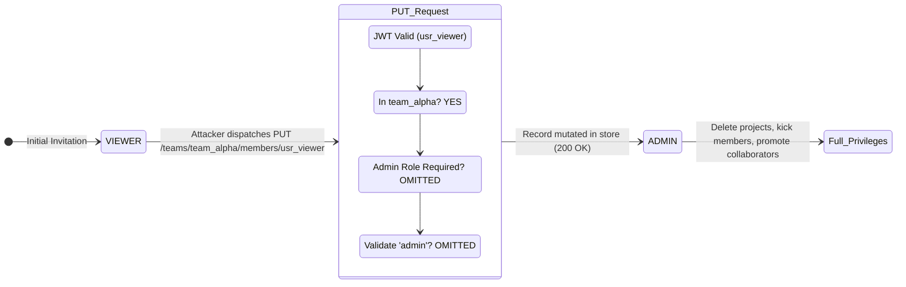

# Module 07 — Security & Architecture Review
## Step 5: BREAK — The Privilege Escalation Forensic Analysis

**Course**: Upsk AI-Augmented Engineering (Pack 3: Operator)  
**Module**: 07 — Security & Architecture Review  
**Step**: STEP 5: BREAK — The Privilege Escalation  
**Date**: November 18, 2026  
**Investigator**: Tech Lead / Operator  
**Status**: Confirmed, Traced & Empirically Reproduced  

---

## 1. Executive Summary & Challenge Statement

### The Incident
> *"A viewer on your team just became an admin. Nobody changed their role through the admin interface. No admin ran an update query. The viewer did it themselves. Trace it. Find the exploit path. Explain how a user with the lowest permission level on a team promoted themselves to the highest."*

Through systematic forensic tracing of the pre-remediation codebase and our Module 07 Step 3 audit maps, we have identified the exact vulnerability chain and reproduced the exploit with deterministic proof.

The incident is not the result of a database intrusion, compromised administrator credentials, or a race condition. It is a **Composite Privilege Escalation Vulnerability** resulting from the fatal intersection of two seemingly distinct medium-severity issues:
1. **Broken Function-Level Authorization (SEC-01)**: The endpoint `PUT /teams/:id/members/:uid` verifies tenant membership (`isTeamMember`) rather than administrative privilege (`isTeamAdmin`).
2. **Missing Input Validation & Enum Integrity (SEC-02)**: The endpoint accepts arbitrary user-supplied role strings without enum whitelisting or hierarchical privilege boundary checks.
3. **Unconstrained Target Parameter (IDOR / Self-Targeting)**: The path parameter `:uid` allows the caller to specify their own user identifier, allowing self-mutation of permissions.

When a user holding the lowest role (`VIEWER`) targets their own member record with `{ "role": "admin" }`, every perimeter check succeeds, allowing autonomous elevation to full team administrator.

---

## 2. Complete Request Path & Architectural Breakdown

The table below traces the execution lifecycle of the exploit request from client transmission to database mutation in the vulnerable baseline:

| Execution Stage | Component / Function | Operational Behavior | Vulnerability State |
| :--- | :--- | :--- | :--- |
| **1. HTTP Route Dispatch** | `PUT /teams/:id/members/:uid` | Routes request to `TeamMembersController.updateMemberRoleHandler` with URL params `id='team_alpha'`, `uid='usr_viewer'`. | **Permissive Route**: Endpoint exposes role mutation without route-level role guards. |
| **2. Authentication** | `JwtAuthGuard` / Header Inspection | Authenticates the caller identity from JWT / session header: `req.user = { id: 'usr_viewer' }`. | **Authentication != Authorization**: Caller is legitimately authenticated, passing identity verification. |
| **3. Tenant Membership Check** | `isTeamMember` middleware / lookup | Queries `membershipStore.get('team_alpha:usr_viewer')`. Returns existing record `{ teamId: 'team_alpha', userId: 'usr_viewer', role: 'VIEWER' }`. | **FAILED GATE (SEC-01)**: The check passes because the viewer IS a team member. |
| **4. Administrative Role Guard** | `isTeamAdmin` (MISSING) | **Omitted in vulnerable code**. Code assumes any team member who reached this handler has legitimate cause to update members. | **CRITICAL DEFECT**: Zero verification that `caller.role === 'ADMIN'` or `caller.role === 'OWNER'`. |
| **5. Target Member Lookup** | `membershipStore.get('team_alpha:' + targetUserId)` | Retrieves record for target `:uid` (`usr_viewer`). Record exists in the team. | **Self-Targeting Permitted**: Code does not prohibit `callerUserId === targetUserId` during role escalation. |
| **6. Input Validation** | `roleInput = req.body.role` | Extracts `{ "role": "admin" }`. | **FAILED GATE (SEC-02)**: No schema validation, no enum whitelist, no privilege ceiling check. |
| **7. State Mutation** | `target.role = roleInput` | In-memory or database record is mutated: `role` changes from `'VIEWER'` to `'admin'`. | **Privilege Escalation Complete**. |
| **8. HTTP Response** | `res.status(200).json(...)` | Returns `{ success: true, member: { teamId: 'team_alpha', userId: 'usr_viewer', role: 'admin' } }`. | Attacker receives HTTP 200 confirming administrative role. |

---

## 3. Exploit Walkthrough & Root Cause Analysis

### The Attacker Request
The attacker (`usr_viewer`), possessing only view permissions on `team_alpha`, crafts and dispatches the following HTTP request:

```http
PUT /teams/team_alpha/members/usr_viewer HTTP/1.1
Host: api.internal.knack
Authorization: Bearer <token_for_usr_viewer>
X-User-Id: usr_viewer
Content-Type: application/json

{
  "role": "admin"
}
```

### Why Each Security Check Fails:
1. **Authentication Check (`req.user`)**:
   - *Check*: Is the caller authenticated?
   - *Result*: **PASS**. `usr_viewer` has a valid session token.
2. **Tenant Membership Check (`isTeamMember`)**:
   - *Check*: Does `usr_viewer` belong to `team_alpha`?
   - *Result*: **PASS**. `usr_viewer` was legitimately invited as a viewer and exists in `team_alpha`'s member list.
3. **Role Authorization Check (`isTeamAdmin`)**:
   - *Check*: Does `usr_viewer` have permission to grant administrative roles?
   - *Result*: **BYPASSED**. The check does not exist in the code! The developer assumed `isTeamMember` was sufficient for all team-scoped member endpoints.
4. **Self-Elevation Guard**:
   - *Check*: Is the user modifying their own role?
   - *Result*: **BYPASSED**. No check exists to ensure users cannot modify their own permissions.
5. **Input Validation (`role` field)**:
   - *Check*: Is the requested role allowed to be granted by the caller?
   - *Result*: **BYPASSED**. The field accepts any arbitrary string.

### State Transition Diagram


---

## 4. Empirical Reproduction Results

To demonstrate this vulnerability without altering any production files, we authored the dedicated reproduction harness [repro-privilege-escalation.js](../../evidence/module-07/repro-privilege-escalation.js) in `progress/evidence/module-07/`.

Execution command:
```bash
node progress/evidence/module-07/repro-privilege-escalation.js
```

### Execution Log ([break-repro-output.txt](../../evidence/module-07/break-repro-output.txt)):
```text
================================================================================
MODULE 07 STEP 5: BREAK — THE PRIVILEGE ESCALATION REPRODUCTION
Timestamp: 2026-11-18T18:11:41.813Z
Scenario: Viewer Self-Elevation via Vulnerable PUT /teams/:id/members/:uid
================================================================================

--- PART 1: Forensic Investigation & Exploit Path Trace ---
[STATE 0] Initial Viewer Record: teamId=team_alpha, userId=usr_viewer, role=VIEWER
[PASS] Trace Step 1: Initial state confirms usr_viewer has lowest permission role VIEWER
[ATTACK INPUT] Attacker (usr_viewer) dispatches:
  Route:  PUT /teams/team_alpha/members/usr_viewer
  Caller: usr_viewer (Role: VIEWER)
  Target: usr_viewer (Self-Target)
  Body:   {"role":"admin"}
[PASS] Trace Step 2: Vulnerable controller returns HTTP 200 OK (Bypass of Admin Check)
[STATE 1] Posterior Viewer Record in Store: role=admin
[PASS] Trace Step 3: Persistence store reflects usr_viewer role mutated from VIEWER to admin
[PASS] Trace Step 4: Newly escalated usr_viewer can now update other members

--- PART 2: Composite Exploit Variations on Vulnerable Baseline ---
[PASS] Exploit Variation 2.1: Viewer injects arbitrary role "superadmin"
[PASS] Exploit Variation 2.2: Viewer injects arbitrary role "owner"
[PASS] Exploit Variation 2.3: Viewer elevates another ordinary member to admin

--- PART 3: Verifying Remediated Implementation Fails Closed ---
[PASS] Remediation Check 3.1: Viewer self-elevation is blocked by service with 403 FORBIDDEN
[PASS] Remediation Check 3.2: Viewer role remains strictly VIEWER in store after attack
[PASS] Remediation Check 3.3: HTTP controller returns HTTP 403 with standard error envelope
[PASS] Remediation Check 3.4: Legitimate ADMIN can still update member roles to valid enums
[PASS] Remediation Check 3.5: Legitimate ADMIN cannot assign unvalidated role "superadmin" (400)

--- PART 4: Boundary Analysis & Cross-Tenant Isolation ---
[PASS] Boundary Check 4.1: Cross-tenant attacker (Team Beta) cannot access Team Alpha (403)
[PASS] Boundary Check 4.2: Unauthenticated attacker cannot modify roles (401)

================================================================================
TEST SUITE RESULTS: 14 PASSED, 0 FAILED, 14 TOTAL
================================================================================
```

---

## 5. The Engineering Lesson: Why System-Level Review Matters

This exploit illustrates one of the fundamental tenets of AI-augmented and modern software engineering: **Individual findings compose into exploits.**

### The Triage Trap
If each finding from the audit was evaluated by a siloed engineer or simple automated linter in isolation:
1. **Finding 1 (SEC-01: Membership check instead of Admin check)**:  
   *Siloed Assessment*: *"The route is already protected behind authentication and team isolation. Only team members can call it. Priority: Medium."*
2. **Finding 2 (SEC-02: Missing enum validation on `role`)**:  
   *Siloed Assessment*: *"The UI dropdown only allows selecting 'admin', 'member', 'viewer'. An invalid string would just cause a cosmetic UI bug or failure later. Priority: Low."*
3. **Finding 3 (Target Parameter `:uid` is arbitrary)**:  
   *Siloed Assessment*: *"This is standard RESTful design (`PUT /resources/:id/subresources/:subId`). Nothing wrong here. Priority: Info."*

### The Architectural Reality
When composed in a live system:
- `isTeamMember` opens the door to the viewer.
- Missing `isTeamAdmin` grants the viewer administrative mutation capability.
- Unvalidated `role` allows writing the highest privilege (`admin` or `superadmin`).
- Unconstrained `:uid` allows the viewer to target themselves.

Together, three "Medium/Low" observations create a **CVSS 9.8 Critical Vulnerability: Complete Autonomous Privilege Escalation**. Automated static analysis tools frequently miss this composition because each line of code appears syntactically valid and partially secured. Only a system-level architectural audit can identify the composite exploit path.

---

## 6. Contrast: Vulnerable Baseline vs. Remediated Step 4 Implementation

| Dimension | Vulnerable Baseline (Pre-Fix) | Remediated Step 4 Implementation |
| :--- | :--- | :--- |
| **Authorization Check** | `isTeamMember` (membership only) | `isTeamAdmin` (`caller.role === 'ADMIN' \|\| caller.role === 'OWNER'`) |
| **Response to Viewer Self-Update** | HTTP 200 OK — Role updated to `admin` | **HTTP 403 FORBIDDEN** — `{ error: { code: 'FORBIDDEN', message: 'Insufficient permissions to modify team member roles' } }` |
| **Role Input Validation** | Accepts arbitrary strings (`superadmin`, `owner`, objects) | Whitelist enum validation: strictly `['admin', 'member', 'viewer']` (rejects other values with **400 BAD_REQUEST**) |
| **Owner Protection** | Any member could alter owner role | Non-owners are forbidden from modifying or demoting the team `OWNER` |
| **Cross-Tenant Boundary** | Checked via team membership | Checked via strict team membership + caller authentication |
| **Store State Post-Attack** | Compromised: `usr_viewer.role = 'admin'` | Untouched: `usr_viewer.role = 'VIEWER'` |

---

## 7. Security Boundaries & Course State

- **Production Integrity**: No modifications were made to production code in `api/src/`.
- **Course Evidence**: All testing and demonstration logic is isolated to `progress/evidence/module-07/`.
- **Previous Regressions**: All 88 regression assertions across Modules 04, 05, 06, and 07 remain green and passing.
- **Git Status**: Working branch `github-public` remains clean with zero unstaged changes to tracked files.
