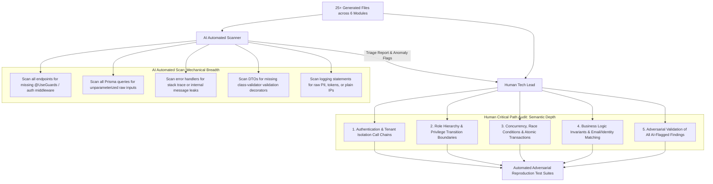

# Module 07: Security & Architecture Review — STEP 2: DECIDE
## Decision: Security Review Scope — Option B: AI-Assisted Hybrid + Manual Critical Path

**Course**: Upsk AI-Augmented Engineering (Pack 3: Operator)  
**Module**: Module 07 — Security & Architecture Review  
**Step**: STEP 2: DECIDE — Security Review Scope  
**Selected Strategy**: **Option B — AI-Assisted Hybrid + Manual Critical Path**  
**Stored State**: `decisions.module_07.security_review_scope = ai_assisted_hybrid`  
**Date**: November 18, 2026  

---

## 1. Context & Trade-Off Analysis

Having accumulated six modules of AI-generated code spanning teams, roles, invitations, comments, mentions, activity feeds, audit trails, and WebSockets (~25+ files, hundreds of lines of code), we face a classic engineering resource constraint: **finite review time vs. extensive codebase surface area**.

### Comparison Matrix

| Dimension | Option A: Full Manual Audit (`full_manual`) | Option B: AI-Assisted Hybrid + Manual Critical Path (`ai_assisted_hybrid`) [Selected] |
| :--- | :--- | :--- |
| **Operational Workflow** | Open and read every generated file line-by-line; trace every route, helper, and model by hand. | Use AI for broad, brute-force pattern scanning across all files; reserve manual human scrutiny exclusively for the critical path. |
| **Volume Scaling** | Extremely poor. Reviewing 25+ files sequentially takes hours; human stamina degrades rapidly. | Excellent. AI screens hundreds of lines in seconds, flagging syntax anomalies, missing guards, and unvalidated inputs. |
| **Primary Failure Mode** | **Reviewer Fatigue / Skimming**: By file 18, human attention wanders, pattern recognition dulls, and subtle flaws pass through unnoticed. | **AI Blind Spots / Training Alignment**: The AI scanner shares the generator's biases and misses business logic, complex authorization chains, or subtle bypasses. |
| **Mitigation for Failure Mode** | Frequent breaks and multi-reviewer rotations (often impossible under single-engineer sprint deadlines). | **Zero-Trust Validation & Critical Path Focus**: The human never trusts AI clean bills of health on the critical path; AI output is treated solely as an untrusted advisory triage signal. |
| **Coverage Quality** | Deep on the first 5–10 files; superficial on remaining files due to cognitive exhaustion. | High-breadth mechanical coverage across 100% of files; maximum human depth on 100% of high-risk call chains. |

---

## 2. Principled Justification for Option B

### A. The Cognitive Reality of Reviewer Fatigue
The fatal flaw of Option A is not a lack of technical competence, but biological reality. When an engineer attempts a 100% manual review of 25 files across 6 different functional modules, cognitive fatigue sets in. As highlighted in the official course materials:
> *"What does a human miss? Volume. Humans are bad at checking 200 endpoints for the same repetitive property. We lose focus. We skip the ones that 'look fine.' Automated scanning excels at exactly this -- brute-force checking every instance of a pattern."*

Attempting to manually inspect every helper function, DTO decorator, and utility method dilutes cognitive energy away from the critical security surfaces where severe vulnerabilities actually live.

### B. Division of Labor: Repetitive Checks vs. Human Judgment

To optimize review efficacy, we establish a strict operational division of labor:

#### What AI Performs (Repetitive Pattern Auditing):
1. **Perimeter Guard Completeness**: Scans all controller classes and route handlers for missing `@UseGuards(JwtAuthGuard)` or equivalent auth decorators.
2. **DTO & Input Validation**: Scans all endpoint signatures to verify incoming request bodies pass through `ValidationPipe` with strictly typed DTOs.
3. **Information Disclosure & Error Handling**: Scans exception catch blocks and filters to ensure no raw database errors, Prisma exceptions, or stack traces leak to HTTP clients.
4. **PII Logging Patterns**: Scans log and audit invocations for cleartext keywords (`password`, `token`, `secret`, `req.ip`).

#### What Humans Audit Exclusively (The Critical Path):
1. **Complete Mediation in Call Chains (Step 1 Category 2)**: Tracing public routes to database queries to ensure that even if an internal function has optional parameters (like `comments.service.js`), the caller cannot bypass tenant checks.
2. **Business Logic & Privilege Elevation (Step 1 Category 1)**: Verifying that role hierarchies (`OWNER > ADMIN > MEMBER`) are strictly enforced and cannot be overridden by unauthorized team members.
3. **Data Integrity Under Pressure (Step 1 Category 4)**: Auditing invitation token acceptances, task deletions, and activity feed reloads for `$transaction` atomicity, row-level locking, and idempotent state transitions.
4. **Compliance & Hashing (Step 1 Category 5)**: Verifying that IP addresses and sensitive identifiers are hashed with salted HMAC rather than logged in plain text.

---

## 3. Independent Validation Protocol: Avoiding the "AI Validating AI" Trap

The prompt rightly identifies the core hazard of Option B:
> *"AI scanning AI-generated code has a specific failure mode: the scanner was trained on the same patterns as the generator. It has the same blind spots. It will not catch mistakes that are 'normal' in AI-generated code because those mistakes look correct to the scanner too."*

To neutralize this hazard, our methodology mandates **Empirical Adversarial Validation**:
1. **Never Accept a "Clean Scan" on the Critical Path**:
   A report from an AI scanner stating *"No authentication issues found"* is treated as zero evidence. On authentication, authorization, and data mutation paths, the human auditor independently reviews the code regardless of scanner output.
2. **Independent Adversarial Tests**:
   For any finding flagged by the AI—or any critical path audited by the human—we author an independent reproduction script (e.g., `repro-idor.js`, `repro-break.js`, `verify-edge-cases.js`). We prove the vulnerability exists by observing a failing test, and prove the fix works by observing a passing assertion.
3. **Multi-Model / Different-Prompt Evaluation**:
   When using AI assistance, we prompt with explicit adversarial personas ("Act as an offensive penetration tester auditing an IDOR vulnerability") rather than general review prompts, preventing the model from lazily reaffirming generated patterns.

---

## 4. Official Decision Record

- **Choice**: **Option B — AI-Assisted Hybrid + Manual Critical Path** (`ai_assisted_hybrid`)
- **Reasoning**:
  > I choose Option B (AI-Assisted Hybrid + Manual Critical Path) because auditing 25+ generated files manually across 6 modules induces reviewer fatigue, inevitably causing reviewers to miss critical flaws by file 18. An AI scanner efficiently handles high-volume, repetitive syntactic pattern checks (missing route guards, unvalidated DTOs, leaked stack traces, and unhashed PII). This liberates 100% of human cognitive bandwidth to focus exclusively on the critical path: end-to-end call-chain authorization, tenant isolation, role hierarchy enforcement, race condition transactions, and business logic invariants—with all findings independently validated through automated reproduction test harnesses.
