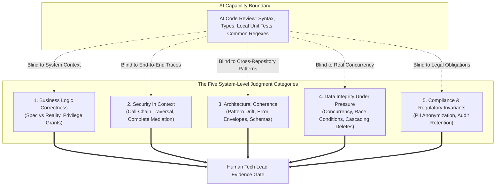

# Module 07 — Security & Architecture Review
## Step 1: CONTEXT — What AI Cannot Judge

**Course**: Upsk AI-Augmented Engineering (Pack 3: Operator)  
**Module**: 07 — Security & Architecture Review  
**Step**: STEP 1: CONTEXT  
**Date**: November 18, 2026  
**Status**: Step 1 Completed  

---

## Executive Summary: The System-Level Review Gap

Over the preceding six modules, our AI-augmented engineering process produced substantial application components across multiple functional domains:
- **Module 01 & 02**: Task decomposition, Team models, and schema migrations.
- **Module 03**: Layered context engineering, standard error envelopes (`SafeErrorEnvelope`), and DTO contracts.
- **Module 04**: Critical review, Role-Based Access Control (RBAC), and team invitation workflows.
- **Module 05**: Iteration patterns, real-time WebSocket activity feeds (`ActivityFeedGateway`), room isolation, and heartbeat sweep protocols.
- **Module 06**: Parallel agent orchestration, threaded task comments (`CommentsService`), `@mention` parsing and notifications (`MentionNotificationService`), and audit logging (`AuditService`, `AuditMiddleware`).

Every single component was reviewed, tested, and validated at the **individual-task level**. In isolation, each function's unit tests pass, schemas compile, and linting rules succeed.

**However, none of this code has been reviewed as an integrated system.**

Individual code review verifies that a function behaves according to its localized prompt and unit test harness. System-level review evaluates how functions, services, background workers, and transport boundaries interact under real-world operational conditions. AI agents are structurally incapable of conducting holistic system-level review because they operate within isolated context windows and lack access to business intent, end-to-end call chains, operational concurrency pressures, and regulatory compliance mandates.

---

## The Five Categories What AI Cannot Judge



---

### Category 1: Business Logic Correctness (Product Spec vs. Prompt Execution)

#### The Conceptual Failure Mode
An AI model builds what it was prompted to build, but it cannot know whether the prompt correctly captured the product requirements. An implementation can be clean, robustly tested, and fully conformant to a prompt, yet completely wrong from a business perspective.
- *Example*: The product requirement states: *"Only Team Owners and Admins may invite new members; standard members cannot."* If an AI generates code where any team member can generate an invitation token, the code compiles, the unit tests written by the AI pass, and the feature is a critical business failure.

#### Concrete Codebase Evidence
In **Module 04 (`invitations.service.ts`)**, during initial code generation, the agent implemented an invitation acceptance method that validated token expiration and updated database records. However, it omitted checking whether the accepting user's email matched the invited email address (`invitedEmail !== acceptingUser.email`). The code was syntactically flawless and passed happy-path tests, but allowed any authenticated user holding an invitation token to hijack invitations meant for third-party corporate domains. The AI could not evaluate the business intent of an invitation.

#### Human Evidence Gate
The human engineer must audit business authorization matrices against original product specifications:
- Verify that role hierarchies (`OWNER > ADMIN > MEMBER > VIEWER`) are strictly enforced at every route handler.
- Verify that invitation tokens are bound to specific email domains and identity claims.

---

### Category 2: Security in Context (Call-Chain Traversal vs. Isolated Functions)

#### The Conceptual Failure Mode
A function can be completely secure in isolation while being catastrophically exploitable when invoked within an application's call chain. AI tools review functions; human engineers review call chains.
- *Example*: An `updateMemberRole(teamId, memberId, newRole)` function validates that `newRole` is a valid enum, sanitizes SQL inputs, and executes parameterized database updates. In isolation, the function has 0 security vulnerabilities. But if the HTTP controller endpoint invoking this function fails to verify that the *caller* is an Admin of `teamId`, the entire system is vulnerable to privilege escalation.

#### Concrete Codebase Evidence
1. **Module 04 IDOR Vulnerability (`invitations.controller.ts` vs `invitations.service.ts`)**:
   `updateInvitationStatus(invitationId, status)` properly updated the database. However, the controller did not verify that the caller was an admin of the team that issued the invitation. Any logged-in user could cancel or approve pending invitations across foreign tenants.
2. **Module 06 Optional-Argument Authorization Bypass (`comments.service.js`)**:
   ```javascript
   // Isolated function looked "safe" if 2 arguments were provided:
   getComments(taskId, callerUserId) {
     if (arguments.length > 1) {
       // verified team membership
     }
     return this.commentStore.get(taskId);
   }
   ```
   In isolation, unit tests passing both arguments verified tenant boundaries. But in the call chain, any controller or service caller invoking `getComments(taskId)` with one argument bypassed authentication entirely, dumping sensitive threaded discussions across tenant boundaries. Complete mediation was only restored when the human engineer recognized that security must fail closed.

#### Human Evidence Gate
- Trace every public HTTP/WebSocket route to the database layer.
- Ensure authentication and tenant tenancy checks occur at the perimeter, refusing to trust downstream optional parameters.

---

### Category 3: Architectural Coherence (Preventing Pattern Drift & Fragmentation)

#### The Conceptual Failure Mode
Codebases maintain intentional architectural conventions: centralized exception filters, standardized DTO validation pipes, structured JSON logging with correlation IDs, and unified pub/sub buses. When multiple AI agents implement features independently, each introduces localized patterns:
- Agent A uses NestJS `HttpException` with custom error payloads.
- Agent B returns `{ success: false, error: "message" }`.
- Agent C throws raw JavaScript `Error` objects caught by Express middleware.
- Agent D executes raw SQL queries while Agent E uses an ORM repository.

Each file works in isolation, but the codebase becomes fragmented, defeating centralized monitoring, metrics collection, and client error handling.

#### Concrete Codebase Evidence
1. **Module 03 Context Standardization**:
   Our platform mandates `SafeErrorEnvelope`:
   ```json
   {
     "statusCode": 400,
     "error": "BAD_REQUEST",
     "message": "Validation failed",
     "timestamp": "2026-11-18T22:00:00.000Z",
     "requestId": "req_abc123"
   }
   ```
   Without negative prompt constraints, subsequent agents repeatedly defaulted to standard NestJS `{ statusCode: 400, message: "..." }` or ad-hoc strings, breaking frontend client deserializers.
2. **Module 06 EventBus vs. Middleware Architectural Split**:
   Agent 1 implemented comments using an in-memory pub/sub `EventBus`. Agent 3 implemented audit logging using HTTP route middleware (`audit.middleware.js`). Because contracts failed to mandate the system-wide integration architecture, comments were never recorded in the audit store. Only human intervention created the unified `SystemIntegrationContract`.

#### Human Evidence Gate
- Enforce automated linting rules and custom architectural tests verifying that all controller routes utilize `SafeErrorEnvelope`.
- Validate that all cross-cutting domain mutations emit standard events defined in a central `ResourceTypes` registry.

---

### Category 4: Data Integrity Under Pressure (Concurrency, Race Conditions & Cascading Failures)

#### The Conceptual Failure Mode
AI models generate code optimized for the sequential "happy path": one user performing one action at a time. In production, systems experience concurrent traffic, partial network drops, database deadlocks, and cascading entity deletions.
- *Example*: Two users simultaneously accept an invitation token that has a maximum usage count of 1. Without database-level row locking (`SELECT FOR UPDATE`) or atomic database transactions (`prisma.$transaction`), both acceptances succeed.
- *Example*: A team is deleted while a user is actively posting a comment to a task in that team. What happens to the comment? Does it orphan? Does the WebSocket server crash when publishing to a deleted team's room?

#### Concrete Codebase Evidence
1. **Module 05 WebSocket Reconnection Race Condition (`repro-spiral.js`)**:
   When a client reconnected to `ActivityFeedGateway`, historical events were replayed from the database concurrently with new live events arriving over the pub/sub channel. Without temporal gating and sequence buffering, events arrived out of order, corrupting client activity feeds. The AI agent proposed patching the payload shape rather than diagnosing the underlying concurrency race.
2. **Module 05 Heartbeat Liveness vs. Downlink Delivery**:
   The AI assumed that successfully sending a downstream WebSocket event proved the client was alive. In reality, TCP send buffers accept packets even when a mobile client has dropped carrier signal, masking client disconnections until an explicit Ping/Pong sweep was implemented.

#### Human Evidence Gate
- Audit all state mutations for concurrency protection: atomic transactions, optimistic locking (`version` field), or distributed locks.
- Verify cascading deletion behaviors (`ON DELETE CASCADE` vs `ON DELETE RESTRICT`) across relational schemas.

---

### Category 5: Compliance & Regulatory Invariants (PII, Data Sovereignty & Audit Retention)

#### The Conceptual Failure Mode
AI models possess no awareness of legal, contractual, or regulatory mandates (GDPR, CCPA, SOC 2, HIPAA, PCI-DSS). An AI asked to "build an audit log" will happily log incoming request bodies, inadvertently writing user passwords, plaintext credit card numbers, or session tokens into persistent logs.
- *Example*: Regulations dictate that user IP addresses must not be stored in plaintext. An AI agent logging HTTP requests will log `req.ip` directly unless an engineer mandates an anonymized hash (`ipHash`).

#### Concrete Codebase Evidence
1. **URL Shortener Analytics Pipeline (`api/src/analytics/ip-hash.util.ts`)**:
   To comply with privacy regulations, client IP addresses are never written to PostgreSQL; they are hashed with HMAC-SHA256 using a rotated daily salt (`ipHash`). AI agents generating click tracking services consistently defaulted to logging raw IP strings until explicit privacy constraints were injected.
2. **Module 06 Audit Logging Query Filters & Deduplication**:
   Audit trails must maintain non-repudiation and precise filtering. In Module 06, `AuditService.query()` initially failed to filter by `action`, returning delete records during create audits. Furthermore, sensitive user metadata was initially logged in unindexed raw JSON blobs before structured schemas were enforced.

#### Human Evidence Gate
- Verify that PII (passwords, JWT secrets, raw IPs, payment info) is strictly scrubbed or hashed prior to logging.
- Ensure audit records are immutable (append-only) with no `UPDATE` or `DELETE` endpoints exposed to application roles.

---

## System Integration Map: The Six Modules as One System

The table below maps the cross-cutting failure surfaces across the entire application:

| Feature / Domain | Module | Upstream Dependency | Downstream Interaction | AI Blind Spot |
| :--- | :---: | :--- | :--- | :--- |
| **Team Management** | M01, M02 | Authentication JWT | Invitation workflows, Task scoping | Cascading deletion orphans tasks and audit logs if foreign keys lack strict constraints. |
| **Invitations & RBAC** | M03, M04 | Team models, User identity | Email dispatch, Token claim | Token hijacking if email matching is not verified; IDOR if route lacks team tenancy check. |
| **Activity Feed Gateway** | M05 | Redis Pub/Sub, JWT handshake | WebSocket clients, Room broadcast | Heartbeat liveness assumptions; race condition between replayed and live events. |
| **Task Comments** | M06 | Task store, Team tenancy | Mention parser, EventBus | Optional-argument authorization bypass; orphan comments when parent task is deleted. |
| **Mention Notifications** | M06 | Comments text stream | User notification store, AuditBus | Notification spam if mentions are not deduplicated; self-mention filtering bypass. |
| **System Audit Log** | M06 | HTTP middleware, EventBus | Compliance reporting, Query API | Architectural disconnect between pub/sub events and HTTP routes; PII leakage in metadata. |

---

## Action Plan for Module 07 Security & Architecture Review

To execute a comprehensive, tech-lead-grade review across all six modules, we will apply an adversarial, system-wide methodology:
1. **Call-Chain Boundary Audit**: Trace all 15 public endpoints from HTTP/WebSocket controllers down to database queries, verifying that tenant tenancy (`teamId`) and caller identity (`userId`) are validated at the perimeter.
2. **Schema & Migration Integrity Verification**: Audit `schema.prisma` and foreign key relationships to prevent orphaned data under entity deletions.
3. **Concurrency & Race Condition Analysis**: Identify state-changing mutations lacking atomic transaction wrappers (`$transaction`).
4. **Architectural & Error Uniformity Audit**: Ensure all services conform strictly to `SafeErrorEnvelope` and central logging standards.
5. **PII & Compliance Scrubbing Verification**: Confirm that all logs, audit records, and analytics events scrub sensitive identifiers and hash IP addresses.
