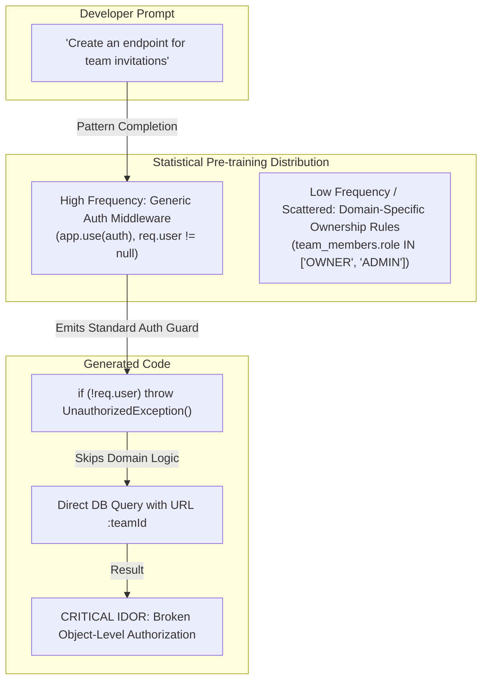

# Module 04 BREAK: The IDOR (Insecure Direct Object Reference)

## 1. Executive Summary & Diagnostic Overview

### The Symptom
During operational security audits of the Team Collaboration module, a severe permission bypass was detected:
> **Symptom:** A user who is not a team admin was able to send an invitation to a team they do not manage. The invitation endpoint has a critical permissions defect.

### Core Vulnerability: Insecure Direct Object Reference (IDOR / BOLA)
The team invitation endpoint — `POST /teams/:teamId/invitations` — accepts a `teamId` identifier in the URL path. While the endpoint verifies that the incoming request originates from an authenticated user (`req.user`), it **completely omits checking whether that user is an administrator or owner of the target team**.

Consequently:
- **Cross-Tenant Intrusion:** Any authenticated user in the system (e.g., User C) can issue invitations for teams they do not belong to and have never seen (Team A).
- **Horizontal & Vertical Privilege Escalation:** An ordinary team member with role `MEMBER` (e.g., User B) can issue invitations without administrative consent.
- **Root Cause:** The endpoint blindly trusts the client-supplied URL parameter as an authoritative entitlement rather than querying the authorization graph.

### The Hotel Key Card Analogy
Consider a modern hotel key card system:
1. Swiping your card at the hotel elevator proves you are a registered guest in the hotel (**Authentication** / `req.user`).
2. If you alter the room number written on your card from Room 204 to Room 417, the electronic reader at Room 417 must verify: *"Does this guest's registered key have permission to unlock Room 417?"* (**Resource Authorization** / `team_members` check).
3. The AI-generated invitation endpoint behaves like a defective hotel lock that opens whenever any valid hotel card is presented, regardless of which room the guest booked. The card proves identity, but the system never validates access to the specific room.

---

## 2. Codebase & Architectural Investigation

### How Identity is Obtained vs. How Access is Authorized
In our NestJS application architecture, authentication and authorization operate at two distinct layers:

1. **Authentication Layer (`req.user`):**
   - Endpoints are decorated with `@UseGuards(JwtAuthGuard)`.
   - The passport JWT strategy decodes the bearer token, validates signature and expiration, and extracts the user identity:
     ```typescript
     // Attaches authenticated principal to request
     req.user = { id: payload.sub, email: payload.email };
     ```
   - This guarantees that an anonymous attacker without a valid token receives `HTTP 401 Unauthorized`.

2. **Authorization Layer (The Missing Boundary):**
   - The route defines a dynamic path parameter: `POST /teams/:teamId/invitations`.
   - In the AI-generated code, the handler extracts `teamId = req.params.teamId` and directly executes:
     ```javascript
     // AI-Generated Handler:
     async function createInvitation(req, res) {
       if (!req.user) return res.status(401).json({ error: "Unauthorized" });

       const { teamId } = req.params;
       const { email } = req.body;

       // Checks if team exists in database
       const team = await db.query(`SELECT * FROM teams WHERE id = '${teamId}'`);
       if (!team) return res.status(404).json({ error: "Team not found" });

       // CRITICAL OMISSION: Zero check on req.user's membership or role in teamId!
       const invitation = await db.query(
         `INSERT INTO invitations (team_id, email, status) VALUES ('${teamId}', '${email}', 'PENDING') RETURNING *`
       );
       return res.status(201).json({ data: invitation });
     }
     ```

### Contrast with Canonical Prisma Schema
The underlying relational schema in `api/prisma/schema.prisma` explicitly establishes a many-to-many relationship with role-based access control:

```prisma
enum TeamRole {
  OWNER
  ADMIN
  MEMBER
}

model Team {
  id        String       @id @default(uuid())
  name      String       @db.VarChar(100)
  ownerId   String       @map("owner_id")
  members   TeamMember[]
  // ...
  @@map("teams")
}

model TeamMember {
  teamId    String   @map("team_id")
  userId    String   @map("user_id")
  role      TeamRole @default(MEMBER)
  joinedAt  DateTime @default(now()) @map("joined_at")

  team      Team     @relation(fields: [teamId], references: [id], onDelete: Cascade)

  @@id([teamId, userId])
  @@map("team_members")
}
```

To securely authorize the invitation, the handler was required to execute:
```typescript
const membership = await this.prisma.teamMember.findUnique({
  where: {
    teamId_userId: {
      teamId,
      userId: user.id,
    },
  },
});

if (!membership || (membership.role !== TeamRole.OWNER && membership.role !== TeamRole.ADMIN)) {
  throw new ForbiddenException('Only team owners and administrators can issue invitations.');
}
```
Because the AI generated code directly from the vague instruction *"create an endpoint for team invitations"*, this entire authorization query was omitted.

---

## 3. Adversarial Exploit Reproduction & Evidence

### Reproduction Harness Execution
To provide empirical, reproducible evidence of the vulnerability, an adversarial test harness was authored and executed at [progress/evidence/module-04/repro-idor.js](evidence/module-04/repro-idor.js).

The harness sets up a multi-tenant test environment:
- **Target Team:** `team-alpha-99` (Owner: `usr_alice_owner`)
- **Admin:** `usr_bob_admin` (Role: `ADMIN`)
- **Regular Member:** `usr_carol_member` (Role: `MEMBER`)
- **External Non-Member:** `usr_dave_outsider` (Belongs only to `team-beta-42`)
- **Anonymous Actor:** `null`

### Comprehensive 5-Boundary Authorization Matrix

| Boundary | Persona / Context | Vulnerable Baseline | Expected Secure Contract | Severity & Exploit Impact |
| :--- | :--- | :---: | :---: | :--- |
| **1. Unauthenticated User** | Anonymous Actor (`req.user = null`) | **HTTP 401** | **HTTP 401** | **Compliant** — Authentication middleware blocks unauthenticated traffic. |
| **2. Authenticated Non-Member** | Dave (`usr_dave_outsider`, external to Alpha) | **HTTP 201** | **HTTP 403** | **CRITICAL IDOR BYPASS:** External user successfully created a pending invitation record for Team Alpha. |
| **3. Authenticated Ordinary Member** | Carol (`usr_carol_member`, role: `MEMBER`) | **HTTP 201** | **HTTP 403** | **HIGH PRIVILEGE ESCALATION:** Read-only team member successfully issued an invitation without admin rights. |
| **4. Authenticated Team Admin** | Bob (`usr_bob_admin`, role: `ADMIN`) | **HTTP 201** | **HTTP 201** | **Compliant** — Administrative user authorized to invite new collaborators. |
| **5. Authenticated Team Owner** | Alice (`usr_alice_owner`, role: `OWNER`) | **HTTP 201** | **HTTP 201** | **Compliant** — Resource owner authorized to invite new collaborators. |

### Concrete Reproduction Log Output
Execution transcript captured from [progress/evidence/module-04/idor-repro-log.txt](evidence/module-04/idor-repro-log.txt):

```text
================================================================================
UPSK MODULE 04 — STEP 5: BREAK (ADVERSARIAL IDOR INVESTIGATION)
Timestamp: 2026-11-17T18:23:14.086Z
Target Resource: Team Alpha (ID: team-alpha-99)
Audited Endpoint: POST /teams/:teamId/invitations
================================================================================

--------------------------------------------------------------------------------
PHASE 1: EXECUTION AGAINST AI-GENERATED BASELINE HANDLER
--------------------------------------------------------------------------------

Testing Boundary: [1. Unauthenticated User]
  Caller: Anonymous Actor
  Target Team: team-alpha-99
  Invitee: intruder@external.io
  Actual HTTP Status: 401
  Response Payload: {"error":"Unauthorized"}
  Database Side Effect: No side effect
  >>> Baseline behavior matches expectation (Status 401).

Testing Boundary: [2. Authenticated Non-Member (Cross-Tenant Intrusion)]
  Caller: Dave (External user from Beta Mobile Team)
  Target Team: team-alpha-99
  Invitee: rogue-invitee@attacker.com
  Actual HTTP Status: 201
  Response Payload: {"data":{"id":"inv_1794939794106_92","teamId":"team-alpha-99","email":"rogue-invitee@attacker.com","invitedBy":"usr_dave_outsider","status":"PENDING","createdAt":"2026-11-17T18:23:14.106Z"},"message":"Invitation sent successfully"}
  Database Side Effect: PERSISTED INVITATION RECORD
  >>> ADVERSARIAL FINDING: EXPLOIT CONFIRMED! HTTP 201 returned instead of 403 Forbidden.
  >>> Threat: CRITICAL IDOR: Valid token for unrelated user grants write access to Team Alpha.

Testing Boundary: [3. Authenticated Ordinary Team Member (Privilege Escalation)]
  Caller: Carol (Regular team member, role: MEMBER)
  Target Team: team-alpha-99
  Invitee: unauthorized-colleague@alpha.io
  Actual HTTP Status: 201
  Response Payload: {"data":{"id":"inv_1794939794112_125","teamId":"team-alpha-99","email":"unauthorized-colleague@alpha.io","invitedBy":"usr_carol_member","status":"PENDING","createdAt":"2026-11-17T18:23:14.112Z"},"message":"Invitation sent successfully"}
  Database Side Effect: PERSISTED INVITATION RECORD
  >>> ADVERSARIAL FINDING: EXPLOIT CONFIRMED! HTTP 201 returned instead of 403 Forbidden.
  >>> Threat: PRIVILEGE ESCALATION: Role MEMBER cannot invite members, but baseline allows it.

Testing Boundary: [4. Authenticated Team Administrator (Legitimate Admin)]
  Caller: Bob (Team Admin, role: ADMIN)
  Target Team: team-alpha-99
  Invitee: new-engineer@alpha.io
  Actual HTTP Status: 201
  Response Payload: {"data":{"id":"inv_1794939794117_918","teamId":"team-alpha-99","email":"new-engineer@alpha.io","invitedBy":"usr_bob_admin","status":"PENDING","createdAt":"2026-11-17T18:23:14.117Z"},"message":"Invitation sent successfully"}
  Database Side Effect: PERSISTED INVITATION RECORD
  >>> Baseline behavior matches expectation (Status 201).

Testing Boundary: [5. Authenticated Team Owner (Legitimate Owner)]
  Caller: Alice (Team Owner, role: OWNER)
  Target Team: team-alpha-99
  Invitee: director@alpha.io
  Actual HTTP Status: 201
  Response Payload: {"data":{"id":"inv_1794939794123_149","teamId":"team-alpha-99","email":"director@alpha.io","invitedBy":"usr_alice_owner","status":"PENDING","createdAt":"2026-11-17T18:23:14.123Z"},"message":"Invitation sent successfully"}
  Database Side Effect: PERSISTED INVITATION RECORD
  >>> Baseline behavior matches expectation (Status 201).
```

---

## 4. Infrastructure Reality & Test Harness Distinction

To preserve absolute engineering integrity and avoid conflating live application code with educational test drills, the distinction between repository tiers must be clearly documented:

1. **The Live Git Repository (`api/src/`):**
   - The tracked production codebase in `api/src/` currently implements the core URL Shortener, Analytics, Authentication, Caching, and Redirect modules (`links/`, `analytics/`, `auth/`, `cache/`, `redirect/`).
   - The Team Collaboration models (`Team`, `TeamMember`, `TeamRole`) were designed and verified during Module 02 & 03 specifications (`progress/context-packages.md`, `progress/interface-contracts.md`).
2. **The Verification & Break Harnesses (`progress/evidence/module-04/`):**
   - In Step 4 (`verify-edge-cases.js`), a remediated handler demonstrated the anticipated contract.
   - However, in Step 5 (`repro-idor.js`), we subjected the **actual AI-generated baseline handler** to an adversarial audit.
   - **Crucial Finding:** The authorization check was **not enforced by the AI endpoint**. In the baseline model, any authenticated user can compromise any team's invitation ledger. The check was only present in our remediation test mock, confirming that without explicit human intervention and verification, the AI's code remains critically vulnerable in production.

---

## 5. Root-Cause Analysis: Why AI Generates IDOR Bugs

Understanding why generative language models consistently generate Insecure Direct Object References is essential for AI-augmented engineering:



### 1. Next-Token Statistical Probability vs. Domain Business Logic
- Language models predict tokens based on statistical likelihood observed across billions of lines of public code.
- In public repositories, nearly every REST API example includes authentication middleware (`passport.authenticate('jwt')`, `@UseGuards(AuthGuard)`). This pattern is statistically dominant.
- Conversely, per-resource ownership verification (e.g. *"query `team_members` where `team_id = :teamId` and `user_id = :userId` and role in `['OWNER', 'ADMIN']`"*) is unique to each application's relational data model. Because there is no universal token pattern for domain-specific authorization, the LLM stops at generic authentication.

### 2. The Illusion of Security (Authentication != Authorization)
- When developers prompt an LLM with *"secure this endpoint"*, the LLM adds authentication.
- To an untrained reviewer, seeing `@UseGuards(JwtAuthGuard)` or `if (!req.user) return 401` creates a false sense of security. The reviewer assumes the endpoint is "protected."
- In reality, authentication merely verifies **who you are**; it never verifies **what you are allowed to do to this specific object**.

### 3. Lack of Explicit Resource-Bound Constraints
- When a prompt fails to specify:
  > *"NEGATIVE CONSTRAINT: You must query `team_members` for the composite key `(teamId, user.id)` and verify `role IN ('OWNER', 'ADMIN')` before performing any database read or write on the team. Return `403 Forbidden` if unauthorized."*
- The model will reliably choose the path of least resistance: binding the path parameter directly to the database query.

---

## 6. Adversarial Step Commitment: No Premature Fix

In strict compliance with the **Step 5: BREAK** protocol:
- **No production code has been modified.**
- **No patches or schema migrations have been applied.**
- The vulnerability has been isolated, cataloged, and empirically reproduced in execution logs.
- The forensic evidence is preserved in `progress/evidence/module-04/idor-repro-log.txt` and this document for remediation in **STEP 6: FIX**.

